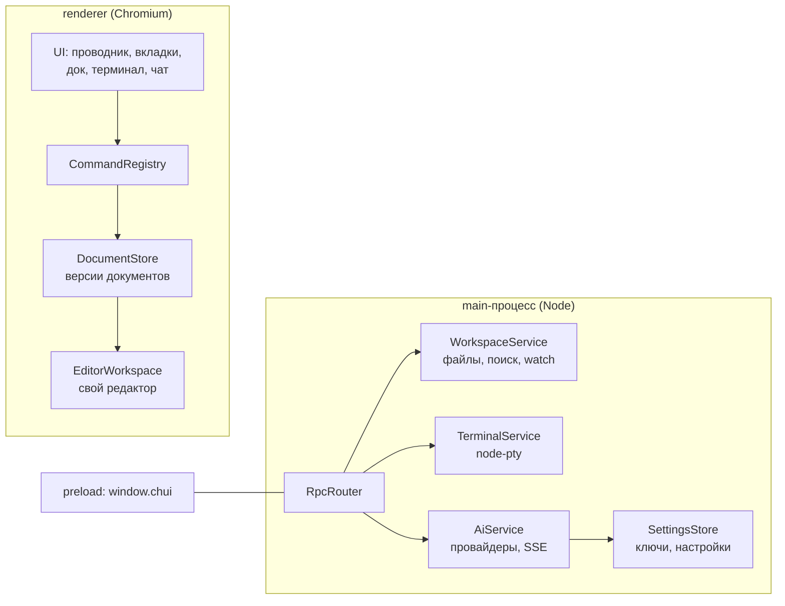

# chui_iDE

IDE на Electron и чистом TypeScript: раскладка в духе PyCharm New UI («острова» со скруглёнными
панелями), собственная светлая и тёмная палитра, подсветка кода цветами VS Code,
настоящий терминал на PTY, документная модель, реестр команд и готовый канал для AI-ассистента.

Смысл проекта — заложить то, что потом дорого переделывать: единый реестр команд,
версионируемый документ, RPC со стримингом и абстракция файловой системы. Ассистент
надстраивается сверху, а не врезается в середину.



## Быстрый старт

```bash
npm install
npm run rebuild        # пересобрать node-pty под ABI Electron (обязательно один раз)
npm run dev            # Vite + Electron, HMR для renderer
npm run build && npm start
```

`npm run dev` берёт профиль `~/.config/chui-ide`, а это один общий замок с установленной
IDE: если она уже запущена (`requestSingleInstanceLock`), dev-экземпляр **молча выйдет**
без единой строки в консоли. Аргументы после `--` уходят в Electron, поэтому рядом можно
поднять dev-окно с отдельным профилем:

```bash
npm run dev -- --user-data-dir=/tmp/chui-dev-profile
```

Проверка кода — одной командой (типы, линт, юнит-тесты):

```bash
npm run check            # typecheck + формат + lint + test — то же гоняет CI
npm run typecheck        # только типы (tsc --noEmit, main и renderer)
npm run lint             # Biome: ошибки и предупреждения
npm run lint:fix         # Biome: починить что можно автоматически
npm run format           # Biome: отформатировать
npm test                 # Vitest: юнит-тесты чистой логики
```

Линт и формат делает Biome (Rust) — у него свой парсер, поэтому он не зависит
от версии пакета `typescript`. Это важно: `typescript-eslint` требует TS < 7,
а проект собирается TS 7, так что связка ESLint + typescript-eslint здесь не работает.

Переводы строк в рабочем дереве — всегда LF, за это отвечает `.gitattributes`
(`* text=auto eol=lf`). Без него формат-проверка падает на Windows: Git с
`core.autocrlf=true` отдаёт файлы с CRLF, а Biome (`lineEnding: "lf"`) видит
переформатированным весь репозиторий и рушит всю проверку на первом шаге (263 файла —
263 ошибки в партии «Проверки на Windows»); в самих файлах при этом всё в порядке.

Юнит-тесты (Vitest) покрывают только чистую логику — без Electron и DOM:
правки текста с не-ASCII, поиск с заменой, проверку сессии, возможности моделей,
реестр языков, палитру тем, помощники чата и отбор файлов для быстрого открытия.
Проверки процессов и окна остаются за smoke-скриптами и «пробниками» ниже.

Проверки процессов и окна — без юнит-раннера, отдельными скриптами:

```bash
npm run smoke:pty        # node-pty в контексте Electron
npm run smoke:terminal   # TerminalService: сессия, ввод, вывод, resize, kill
npm run smoke:window     # арифметика своей рамки: перенос, растягивание, зажим по минимуму
npm run smoke:git        # GitService на временном репозитории: статус, индекс, коммит, diff, ветки
npm run smoke:launcher   # стартовое окно и переход в IDE: два окна, настоящий IPC
npm run smoke:map        # карта проекта: что уходит модели в промпте и что отвечает project_map
npm run smoke:browser    # браузер агента: свой Chromium по CDP на локальной странице
npm run smoke:sandbox    # песочница: команды в настоящем контейнере (нужен docker или podman)
npm run smoke:host       # обратный мост main → renderer: результат, ошибки и отмена
npm run smoke:agent-terminal  # инструменты терминала агента на фейковом pty: провод, ANSI, подтверждение
npm run smoke:anthropic  # Anthropic Messages API без сети: поток SSE, инструменты, thinking, картинки
npm run smoke:commitmsg  # сообщение коммита по diff: инструкция, промпт и очистка ответа
npm run smoke:edits      # правки на не-ASCII тексте: «применено 1» и файл действительно изменился
```

Когда проверка должна заглянуть внутрь настоящего окна IDE, берём «пробники» — они не
оценивают, а печатают состояние:

```bash
./node_modules/.bin/electron scripts/ide-probe.cjs     # открывается ли окно и что в дереве
./node_modules/.bin/electron scripts/fs-probe.cjs      # создание файла и папки, «Обновить», меню редактора
npm run probe:colors                                   # пиксель на экране против токенов темы (Linux + KDE)
npm run probe:menu                                     # меню «☰» настоящими кликами мыши и Alt+F10
npm run probe:settings                                 # поиск по настройкам: выдача, Esc, переход в раздел
npm run probe:mcp                                      # раздел внешних инструментов и проверка серверов
npm run probe:palette                                  # команды своего редактора в нашей палитре
npm run probe:editor                                   # свой редактор: верстка, прокрутка, каретка, выделение
npm run probe:lspbundled                                # языковые серверы из поставки: что нашлось и кто отвечает
npm run probe:typing                                   # ввод в настоящем окне: клик, пары скобок, Ctrl+/, Alt+↓, контекстное меню
npm run probe:saveas                                   # «Сохранить как…»: диалог подменён, копия на диске, переезд вкладки
npm run probe:hunkmenu                                 # правый клик по полоске в жёлобе: меню блока и stage из него
```

«Пробники» возвращают видимые значения вместо `ok`/`FAIL`, потому что у окна IDE есть
подводный камень: `executeJavaScript` до `did-finish-load` копится в очереди, а частые
запросы друг за другом держат поток занятым — окно начинает считаться «не отвечающим».
Поэтому один запрос за раз и с запасом по времени.

Интерфейс можно посмотреть и в обычном браузере — без Electron и его окон: `scripts/ui-mock.js`
подставляется до загрузки страницы и отвечает на те же RPC-вызовы, но данными из памяти
(`page.addInitScript({ path: 'scripts/ui-mock.js' })` против работающего `npx vite`).
Это дешевле скриншотов и не поднимает второе окно.

Мок обязан повторять то же поведение, что и main: дерево он рисует по своим папкам,
а содержимое файлов держит отдельно, поэтому создание, переименование и удаление
правят оба списка. Иначе файл создаётся и открывается в редакторе, но в дереве не
появляется — проверка покажет несовершенство мока, а не ошибку интерфейса.

Требуется Node ≥ 20 (версия для разработки закреплена в `.nvmrc` — 22).
Проверено на Electron 44, Vite 8, TypeScript 7, node-pty 1.1.

### Про нативный модуль

`node-pty` собирается под ABI обычного Node, а в Electron с таким бинарником падает с SIGSEGV.
Поэтому после установки нужен `npm run rebuild` (`@electron/rebuild`). Проверить результат:

```bash
npm run smoke:pty        # node-pty в контексте Electron
npm run smoke:terminal   # TerminalService целиком: сессия, ввод, вывод, resize, kill
```

## Что уже работает

**Старт приложения**

- Приложение открывается стартовым окном (`src/renderer/welcome.html`): кнопки «Открыть проект»
  и «Склонировать проект», список недавних проектов, а если история пуста — заглушка.
- Окно IDE создаётся после выбора: main открывает папку, запоминает её в `settings.json`
  (`workspace.recent`) и создаёт окно редактора. Стартовое окно закрывает сам лаунчер — уже
  получив ответ на `app.openProject`: если закрыть его в main, ответ отправлять будет некуда,
  и вызов в renderer не разрешится никогда. Окно IDE забирает уже открытый корень
  (`workspace.current`), поэтому папку не приходится выбирать дважды.
- Клонирование идёт через `git clone --progress` в выбранную папку, строки прогресса приходят
  в стартовое окно событиями вызова. Папку для клона пользователь выбирает сам, имя берётся из адреса.
- У стартового окна отдельная точка входа и своя сборка: xterm в него не попадает.

**Интерфейс**

- Своя рамка окна: системной шапки нет — есть наша (меню приложения, кнопка запуска,
  действия и кнопки окна), перетаскивание за шапку и растягивание за края.
- Раскладка в стиле PyCharm New UI: фон приложения темнее панелей, панели — «острова»
  со скруглёнными углами, зазоры между ними работают сплиттерами.
- Светлая и тёмная схемы (плюс «как в системе») — палитра устроена по ролям: поверхности,
  текст, линии, акценты. Переключается кнопкой в шапке, из меню «Вид» или палитры команд.
- Подсветка кода — цвета VS Code: Dark+ в тёмной схеме, Light+ в светлой.
- Знак приложения — «[i_i]» в стиле моноширинного шрифта: ровный штрих одной толщины,
  квадратная точка и засечки у «i», квадратные скобки во всю высоту клетки. Он же
  в пустом состоянии редактора и в значке окна (иконка для дистрибутивов — из него же).
- Слева больше нет полосы иконок: все переключатели живут в шапке. Слева — меню,
  боковая панель и работа с содержимым (сохранить всё, поиск, терминал),
  в центре — кнопка запуска открытого файла, справа — ассистент, палитра, настройки,
  тема и кнопки окна. Кнопка ассистента носит знак приложения «[i_i]» — тот же, что
  в пустом состоянии редактора и в значке окна: кнопка и экран говорят одно и то же.
  В подсвеченном состоянии знак красится акцентом, как и
  остальные кнопки панелей.
- Сверху — панель с быстрыми действиями; имя открытого проекта показывает заголовок
  панели проекта (полный путь — в подсказке), а другую папку открывает меню (Ctrl+O).
- Редактор: вкладки с синей полосой у активной, хлебные крошки под ними. Колесо прокручивает
  полосу по горизонтали и доводит вкладку до края: и слева, и справа остаётся тот же отступ,
  что и без прокрутки (6 px). Если вкладки не помещаются, край полосы мягко уходит — по нему
  видно, что дальше есть ещё, и срезанная вкладка не выглядит обрубленной.
- Пустое состояние редактора — знак «[i_i]», имя и подсказки по горячим клавишам: кнопок нет,
  всё, что они делали, есть в меню «☰», в палитре команд и в дереве проекта.
- Снизу — док с вкладками «Поиск» и «Терминал», справа — «остров» AI Assistant.
- В шапке чата отступы такие же, как в полосе вкладок редактора, а крестик есть и у единственной
  беседы: закрытие не оставляет панель без вкладки, а заводит свежую беседу.

**Языки**

- Один реестр языков (`src/shared/languages.ts`): идентификатор языка, подпись, расширения,
  имена файлов, отступы и значок. Из него берут данные редактор, дерево проекта, статусбар и запуск —
  поэтому подпись «Python» и правила подсветки не расходятся.
- Python и Node покрыты целиком: `.py`, `.pyi`, `.pyw`, `requirements.txt`, `pyproject.toml`,
  `Pipfile`, `setup.py`; `ts/tsx/mts/cts`, `js/mjs/cjs/jsx`, `package.json`, `tsconfig.json`,
  `package-lock.json`, `yarn.lock`, `pnpm-lock.yaml`, `.npmrc`, `.env`, `Dockerfile`, `Makefile`.
- Отступы задаёт язык, а не только общие настройки: Python — 4 пробела, TypeScript — 2,
  Makefile — символ табуляции. В статусбаре видно фактическое значение для открытого файла.
- Правила поведения в редакторе прописаны вручную: `Ctrl+/` комментирует строки знаком
  языка (таблица — `editor/input/comments.ts`), а скобки и кавычки закрываются парой.
- JavaScript и TypeScript проверяются настоящим языковым сервисом: `require`/`import` видны,
  импорты разрешаются, неиспользуемый код подчёркивается (отключается в настройках).
- Makefile подсвечивается своим мини-токенизатором: без него рецепты читались бы как обычный
  текст. Грамматика короткая — цель, переменная, рецепт, `include`.

**Запуск кода**

- Кнопка запуска стоит в центре шапки и появляется сама, когда есть что запускать:
  файл Python, Node, Shell или задача из `scripts` в `package.json`. Нечего
  запускать — вместо кнопки там имя открытого файла (оно же есть в статусбаре).
- Запускается то, чем нужно: интерпретатор виртуального окружения проекта
  (`.venv/bin/python` и родственные пути), а без него — `python3`; менеджер пакетов Node
  определяется по `packageManager` или файлу блокировки (`pnpm`, `yarn`, `bun`, `npm`).
- Точка входа отмечена значком ▶ на поле номера строки: `if __name__ == "__main__":`
  в Python, `require.main` — в Node. Клик по значку запускает файл так же, как `Ctrl+F5`.
- TypeScript запускается без сборки: есть в проекте `tsx` или `ts-node` — зовём их, нет —
  выполняет сам Node встроенным стиранием типов (`node file.ts` на 23.6+,
  `node --experimental-strip-types file.ts` на 22.6+). Более старый Node `.ts` не выполняет,
  и запуск тогда честно не предлагается. Отладка `.ts` по-прежнему идёт по source-карте
  собранного `.js` — встроенное стирание типов для неё не используется.
- В тестовом файле Python значок ▶ стоит у каждого `def test_…` (и у тестов внутри класса):
  клик запускает ровно этот тест — командой `pytest файл::Класс::тест`, а не весь файл.
  В тестовом файле JS/TS такой же значок ставят `test('…')` и `it('…')` (с учётом `describe`):
  тест запускается раннером проекта — `vitest <файл> -t '<имя>'`, у jest так же, у `node --test`
  через `--test-name-pattern`.
- Команда набирается в терминале в каталоге проекта: процесс видно, его можно прервать
  и посмотреть вывод. Вкладка терминала называется по запуску (`Запустить train.py`).
- Перед запуском несохранённые файлы сохраняются (отключается в настройках).
- Виртуальные окружения — окно «Python: виртуальные окружения» (меню «Python» или палитра команд по слову `venv`): видно уже найденные, главное помечено, тут же создаётся новое — с выбором найденной в системе версии Python, набором пакетов и зависимостей из `requirements.txt`.
- Импорты с неустановленными библиотеками подчёркиваются прямо в редакторе: `import requests` (Python) или `import { z } from 'zod'` (JS/TS) помечаются предупреждением. Проверка своя, без языкового сервера: у Python IDE спрашивает интерпретатор проекта, что он видит, у JS/TS смотрит `node_modules` — и подчёркивает только то, чего нет. Стандартная библиотека, встроенные модули Node и свои файлы проекта при этом не трогаются. Окружение сменилось или файл открыли заново — проверка повторяется.
- Выбранный интерпретатор виден в статусбаре — клик открывает попап: чем запустится код, откуда взялся интерпретатор и переключатель между системным Python и найденными venv. Тот же выбор берёт языковой сервер — подсказки и запуск не разъезжаются. Сменили окружение или создали новое — IDE переключается сама: инструменты, карта проекта и серверы подсказок перечитываются.
- Пакеты окружения: попап показывает, сколько их стоит, сверяет установленное с `requirements.txt`
  (сколько зависимостей не хватает и какие именно) и ставит их одной кнопкой; то же доступно командой
  «Python: установить зависимости». Вывод `pip` идёт событиями — видно, что происходит.
- Окружение Node видно в попапе по клику на чип «Node.js» в статусбаре: версия Node, менеджер пакетов,
  `engines.node`, поломки (нет `node_modules`, не хватает объявленных зависимостей, нет файла блокировки,
  версия не под `engines.node`) и кнопка «Установить зависимости» — установка идёт в терминал, как и задачи проекта.
- Сведения об окружении (интерпретаторы, окружения, пакеты, поломки) читаются при открытии проекта,
  поэтому попап открывается уже наполненным, а не с пустым телом; при самом открытии попапа снимок
  обновляется — окружение меняется и вне IDE (`git pull`, `pip install`, `npm install`).
- Форматирование: `Shift+Alt+F` или «Форматировать файл» — инструментом проекта. У Python это `ruff`, а без
  него `black` из окружения; у JS/TS и соседних языков (`json`, `css`, `html`, `markdown`, `yaml`) — `prettier`,
  а без него `biome` из `node_modules`; объявленный в `package.json` идёт первым. Правку проводит документ,
  поэтому работает undo; в настройках есть «Форматировать при сохранении», а рядом — «Убирать пробелы в конце
  строк» и «Перевод строки в конце файла» (обе выключены при сохранении по умолчанию).
- Проверка кода: инструмент агента `run_linter` прогоняет линтер проекта — `ruff` у Python, `eslint` или
  `biome` у Node (что объявлено в проекте, то и первым). Движок выбирается по цели: по расширению файла,
  а для проекта целиком — по манифесту в корне (`pyproject.toml` против `package.json`). Файлы не меняются,
  `--fix` не передаётся. Ответ — список найденного (`файл:строка:столбец [уровень] правило сообщение`);
  разбор ответов линтеров — `src/shared/lint.ts`.
- Запуск тестов агенту: инструмент `run_tests` сам определяет, чем гонять тесты проекта (pytest у Python;
  vitest, jest или встроенный `node --test` у Node — по зависимостям и карте проекта), поэтому агенту
  не приходится угадывать команду. Резолвер — `src/main/project/tests.ts`, общий по логике с панелью тестов.
  Прогон подтверждает пользователь (как `run_terminal`), а вывод и код выхода возвращаются агенту:
  ненулевой код — упавшие тесты, а не сбой инструмента.
- У подчёркнутого импорта есть быстрая правка (`Ctrl+.`): «Установить пакет». У Python его ставит
  `pip` в окружение проекта (имя пакета берётся из таблицы: `yaml` → `PyYAML`), у JS/TS —
  менеджер пакетов проекта (`npm`/`pnpm`/`yarn`/`bun`) в терминале. Правка идёт первым пунктом
  в общем списке `Ctrl+.` — рядом с действиями языкового сервера.
- Подсказки не только вводятся: переименование, поиск ссылок, структура файла (символы) и быстрые
  правки от сервера. Набор быстрых правок зависит от того, какой сервер выбран (для Python по умолчанию
  `pylsp`; его код проверяют плагины — линтеры `pyflakes` и `pycodestyle`).
- `Ctrl+T` — поиск символа по всему проекту (`workspace/symbol`): класс, функция или переменная
  без знания файла; список спрашивается у сервера по мере ввода.
- Интерпретатор запоминается на проект (`run.pythonByRoot`): выбор в попапе окружения действует для этого
  проекта и не задевает другие.
- Переменные из `.env` подхватывают все, кто запускает код: установка пакетов, тесты, форматирование,
  терминал и языковой сервер видят одно окружение — строки подключения и токены не нужно повторять `export`.
- Панель тестов (`Тесты` в нижней панели): дерево файл → класс → тест от `pytest --collect-only`,
  запуск любого узла в терминале, кнопка «С покрытием» (`pytest --cov --cov-branch
  --cov-report=term-missing`) — итог виден в сводке («покрытие 92%»), под деревом — разбивка по
  файлам (первыми самые непокрытые) со счётчиком частично покрытых ветвей, а в самих исходниках
  подсвечиваются и строки, которые тесты не исполнили (красноватым), и строки, где ветвь условия
  пройдена лишь наполовину (жёлтым, тише). Частичные ветви берутся из JSON-отчёта покрытия
  (`--cov-report=json`), который прогон кладёт в служебный временный каталог, а не в корень
  проекта (`shared/coverage-json.ts`).
  Исход прогона виден на узле (галочка/крестик): команда уносит в терминал
  печать кода выхода, панель читает её из вывода — оболочка после раннера не завершается, и кода
  выхода из события процесса не взять. Правка тестового файла пересобирает дерево сама — но не
  на каждое нажатие и не в фоне: с паузой в 1.5 с и только когда панель на виду. Сбор не удался —
  панель объясняет причину, а не молчит.
- Та же панель работает и для Node-проекта — раннер выбирается по `package.json`: `vitest`
  (`vitest list --json` — дерево с именами тестов), `jest` (`--listTests` — дерево из файлов, имён
  он не отдаёт) или встроенный `node --test`, если раннера нет, а тестовые файлы есть. Запуск идёт
  про раннер проекта и менеджер пакетов (`npx vitest run`, `pnpm exec vitest run`, `bunx jest`), а у
  `node --test` — самим Node. Покрытие пока умеет только pytest: у Node кнопки «С покрытием» нет,
  чтобы не обещать отчёт, которого не будет.
- Панель проблем (`Проблемы` в нижней панели, команда «Проблемы»): ошибки, предупреждения и
  замечания по всем открытым файлам, сгруппированные по файлам, с числами в заголовке вкладки
  и полем фильтра. Клик по строке открывает файл и ставит курсор на место; `F8` по-прежнему
  ведёт по пометкам по кругу. Собирается из тех же пометок, что и волнистые подчёркивания
  в редакторе (языковой сервер, проверка импортов), — расхождению взяться неоткуда.
- Попап окружения замечает молчаливые поломки: `pyvenv.cfg` не читается, базовый интерпретатор
  из конфига пропал (обновили систему), в окружении нет pip. Это видно до первой неудачной команды.

**Отладчик**

- Отладка файлов Python и JavaScript: `F5` запускает, `Shift+F5` останавливает.
  Python идёт через `debugpy` (протокол DAP), JavaScript — через свой тонкий адаптер:
  он переводит DAP в CDP, которым говорит инспектор Node (`--inspect-brk`).
  Подключиться можно и к уже запущенному процессу: «Отладка: подключиться к процессу…»
  спрашивает порт и работает с тем, что уже работает, — перезапуска нет.
- Точка останова — клик по полю номеров строк или `F9`, шаги — `F10`/`F11`/`Shift+F11`.
  Правый клик по жёлобу — меню точки: условие останова (`n > 100`), счётчик попаданий
  («остановиться на пятом проходе», `>5`, `%5`) и точка в журнал — она печатает сообщение
  с подстановкой значений (`n = {n}`) вместо останова, и рисуется зелёным ромбом.
  Условная и счётная точки — красный ромб, их настройки видны в подсказке. У Python
  первое и второе проверяет сам отладчик, у Node — наш адаптер: CDP условий попаданий
  и сообщений не знает, поэтому останов снимает или печатает уже адаптер.
- Вывод программы и строки точек-журналов видны в панели отладки.
- JavaScript отлаживается по source-картам: точку в собранном `.js` можно поставить
  прямо в `.ts`, и стек ведёт в исходник, а не в сборку. Карту адаптер читает сам
  (в том числе вложенную в файл `data:`-ссылкой). Сам TypeScript не запускается:
  Node его не выполняет, поэтому отлаживается собранный `.js`, а `.ts` — по карте.
- Раздел «Наблюдение» в панели: свои выражения (`total * 2`, `len(items)`), считаются
  в контексте выбранного кадра. Виден и пока программа идёт — выражения можно заготовить
  заранее, посчитаются они на останове.
- Параметры запуска: команда «Отладка: параметры запуска…» спрашивает одним окном аргументы
  командной строки (`--port 8080 --name "my file.txt"`, разбираются как в оболочке — кавычки
  и экранирование работают), переменные окружения (по строке `КЛЮЧ=значение`, перекрывают
  `.env` проекта) и рабочий каталог. Заданные параметры держатся в памяти и в **сессии
  проекта** — после перезапуска IDE `F5` запускает программу с ними же; «Сбросить» в том же
  окне их забывает. Наблюдаемые выражения тоже помнятся в сессии проекта.
- Панель «Отладка» в нижнем доке: стек вызовов (клик по кадру открывает его и ставит курсор),
  переменные выбранного кадра с ленивым раскрытием, строка останова подсвечена в редакторе.
  Остановились в файле, которого нет на экране, — IDE сама открывает его на нужной строке.
- Значение под курсором: в остановленном файле наведение на имя показывает значение и тип
  (`total = 42 — int`) — не только на строке останова, но и рядом: выражение считается в том кадре,
  чьи файл и строка под курсором (такого нет — в верхнем). Обрабатываются Python и JavaScript/
  TypeScript. Ошибки выражений в подсказке не показываются — навести можно на что угодно.
  В панели переменных длинные значения обрезаются многоточием — при наведении видно их целиком.
- Правка значений: двойной клик по переменной в панели задаёт новое (панель показывает то,
  что вернул отладчик, — значение может приводиться к типу). Так же правится значение
  наблюдаемого выражения — двойной клик по нему (`setExpression`), полезно для `items[0]`,
  которым в дереве переменных отдельной строки нет.
- Отладчик берёт интерпретатор окружения проекта и его `.env` — то же окружение, что у запуска,
  тестов и языкового сервера. Адаптер запускается по stdio, порт не занимается.
- Останов по исключению: в панели две галочки — необработанные и любые (в том числе
  пойманные). Для JavaScript это состояние `Debugger.setPauseOnExceptions`, для Python —
  фильтры debugpy (`uncaught`/`raised`); перевод делает main, клиент даёт понятные флаги.
- Точки останова и останов по исключению помнятся в **сессии проекта**: закрыли IDE,
  вернулись — значки на месте, как и параметры запуска с наблюдениями.

**Проводник**

- Значки файлов и папок нарисованы своими руками (`ui/file-icons.ts`): цвет и буква говорят
  о виде файла (JS, TS, PY, `{}`, MD, `$`), у папок свои тона для `src`, `tests`, `dist`,
  `node_modules`, `.git`. У каждого вида свой тон; в тёмной схеме оттенки насыщеннее,
  в светлой — темнее (на белом светлые тона для мелких глифов бледны).
  Те же значки показываются в списке изменённых файлов в чате.
- Вид и поведение дерева настраиваются: значки, плотность строк, отступ уровня,
  сортировка, папки выше файлов, скрытые файлы, шаблоны исключений, пометки git,
  открытие по одинарному клику и подтверждение удаления.
- Рабочая область из НЕСКОЛЬКИХ папок в одном окне (команда «Добавить папку в рабочую область»):
  дерево показывает каждый корень верхней строкой, клик по нему делает папку активной и
  сворачивает/раскрывает её, правый клик — «сделать активной» и «убрать из рабочей области».
  Активный корень задаёт, что видит git, поиск и запуск, когда файл не назван явно; путь файла
  в статусбаре и заголовке считается от того корня, которому файл принадлежит (вложенные папки —
  обычное дело). Доступ к файлам проверяется по всем корням, а правила исключения (`.gitignore`,
  `.ai_ignore`) и наблюдатель — свои у каждого корня (`shared/workspace-roots.ts`,
  `main/workspace/workspace.ts`). Список корней хранится в сессии проекта, поэтому рабочая
  область переживает перезапуск.
- По всем корням сразу видна и git-сводка: панель «Изменения» показывает строку на папку
  (ветка, ahead/behind, число правок), а клик по ней делает корень активным.
- Статусбар как в PyCharm: путь к файлу, `строка:столбец`, `LF`, `UTF-8`, отступ, язык,
  а у Python-проекта — виджет окружения: клик открывает попап с выбором интерпретатора и списком venv.

**Git**

- Ветка и число файлов с правками — в статусбаре; клик открывает панель изменений.
- Рабочая область из нескольких папок: панель «Изменения» показывает сводку по всем корням —
  строку на папку (ветка, расхождение с удалённой, число правок), клик переключает активный
  корень. Сводка считается в main (`shared/git-multiroot.ts`, RPC `git.summary`) и приходит
  push-событием, поэтому правки в неактивной папке тоже видны. Сами операции (индексация,
  коммит, сравнение) идут по АКТИВНОМУ корню.
- Панель «Изменения» в нижнем доке (`Ctrl+Shift+G`): поле сообщения коммита, два списка —
  проиндексированные и остальные правки, у каждой строки кнопка индексации. В монорепо списки
  дополнительно разложены по пакетам (`shared/monorepo.ts`, `main/project/packages.ts`):
  пакеты находятся по манифестам (`package.json` с `workspaces`, `pyproject.toml`, `setup.py`),
  файл относится к самому глубокому из вмещающих пакетов, служебные каталоги (`node_modules`,
  `dist`, `.venv`) не обходятся.
- Файлы помечены буквами и цветом и в дереве проекта, и в списке изменений: `M`, `A`, `D`,
  `R`, `U` (новый), `!` (конфликт).
- Сравнение версий — отдельный экран поверх редактора (`Escape` закрывает): `staged` сравнивается
  с `HEAD`, остальное — с индексом. Открывается кликом по строке изменения.
- Замечания к коду в сравнении (свой код-ревью): у строки оставляют замечание (клик по её номеру),
  ответы идут в треде, тред помечается решённым, решённые прячутся и сносятся одной кнопкой.
  Замечание помнит файл, сторону сравнения (было/стало), номер строки и её текст — ориентир на
  случай, если строки сдвинулись. Лента замечаний — колонкой справа от сравнения (кнопка в шапке или команда `git.reviewComments`);
  метка у номера строки ведёт к треду, переход прокручивает сравнение к нужной строке. Хранятся в
  проекте — `.chui_ide/review.json` (`shared/review.ts`, `main/project/review-store.ts`,
  `core/review-model.ts`), поэтому переживают перезапуск и едут вместе с кодом.
- Переключение ветки — списком в панели; откат правок и коммит с пустым индексом
  спрашивают подтверждение системным диалогом.
- Большие файлы (Git LFS, команда `git.lfs`): окно показывает, доступен ли `git-lfs`,
  какие шаблоны ведёт хранилище (строки `.gitattributes`) и какие файлы под ними, у
  каждого — «на диске» или «не подтянут». Шаблон можно взять под LFS и отпустить
  (`git lfs track`/`untrack`), подтянуть содержимое (`git lfs pull`) и поставить хуки
  репозитория (`git lfs install --local`). Без установленного `git-lfs` окно не молчит —
  объясняет, чего не хватает: `shared/git-lfs.ts` (разбор), `ui/lfs-modal.ts` (окно).
- Личность автора и подпись (команда `git.identity`): имя и почта автора, подпись коммитов и
  тегов (`commit.gpgsign`/`tag.gpgsign`), формат подписи GPG (`openpgp`) или SSH-ключом, ключ
  (`user.signingkey`), хранилище паролей HTTPS (`credential.helper`) и список открытых ключей из
  `~/.ssh` с копированием публичной части. Правки пишутся в ЛОКАЛЬНЫЙ конфиг репозитория —
  глобальные настройки человека не трогаются. Окно сразу показывает, чего не хватает: нет имени,
  почта не похожа на адрес, подпись включена, а ключа на машине нет (`shared/git-identity.ts`).
- Соавторы коммита: кнопка «Соавтор» в панели изменений дописывает строку `Co-authored-by` в
  сообщение (имя и почта спрашиваются диалогом), уже указанные видны над кнопкой и убираются
  одной кнопкой; повтор не добавляется.
- Сообщение коммита по diff: кнопка со искрой в панели изменений (команда `git.generateCommitMessage`)
  читает правки и предлагает текст. Это не беседа и не агент — один запрос к модели без истории,
  инструментов и карты проекта (`ai.commitMessage` рядом с подсказками, `shared/commit-message.ts`:
  обрезка diff по потолку и очистка ответа). Diff собирает main (`git.commitDiff`): с
  проиндексированными правками — индекс против HEAD (ровно содержимое будущего коммита), без
  них — рабочее дерево против индекса; новые файлы в `git diff` не видны, поэтому едут отдельным
  списком имён. Текст ложится В ПОЛЕ, а не коммитится сразу: его читают и правят. Тело ответа
  чистится от ограждений, кавычек и подписи «Сообщение коммита:» — в `git log` это лишнее,
  модель же любит это добавлять. Обрезка diff видна отдельным тостом: модель видела не всю
  правку, тему стоит проверить. Проверка — `npm run smoke:commitmsg` (локальный SSE-сервер и
  подставная модель: инструкция, diff в промпте, снятие ограждения и точки в теме).
- Запросы на слияние (PR/MR, команда `git.pullRequests`): список запросов площадки с номером,
  заголовком, ветвями `источник → цель`, автором, метками и состоянием (открыт, черновик, слит,
  закрыт); «Открыть» ведёт на страницу запроса в браузере, «Забрать ветку» переключает рабочее
  дерево на ветку запроса, «+» создаёт новый запрос (заголовок, описание, целевая ветка, черновик).
  Площадка узнаётся по адресу удалённого репозитория (https, ssh, ssh://, вложенные пространства
  имён GitLab), а всю работу с API берёт на себя консольный клиент `gh`/`glab` — своих токенов IDE
  не заводит. Без клиента или без входа окно говорит об этом словами, а не показывает пустой
  список (`shared/git-platform.ts`, `ui/forge-modal.ts`).
- Синхронизация с удалённым: кнопки `fetch`, `pull`, `push` в шапке панели, рядом — расхождение
  с удалённой веткой (`↑` уехало, `↓` не подтянуто). Первая отправка ветки сама ставит upstream
  (`-u origin`); принудительная — через `--force-with-lease`, а не `--force`. Итог операции виден
  уведомлением, а сбой (нет remote, отказ авторизации, конфликт) приходит текстом от git.
- Полоски изменений в жёлобе редактора: добавленные, изменённые и удалённые строки файла
  относительно `HEAD` (`lineChanges` в `shared/git-line-changes.ts` — построчный diff с отсечением
  общих краёв). Клик по полоске переводит на строку и показывает автора (blame). Включены по
  умолчанию, команда `git.toggleChangeGutter`.
- Правый клик по полоске — действия с ОДНИМ блоком правок, не открывая сравнение: «Проиндексировать
  это изменение» (`git apply --cached`), «Убрать это изменение из индекса», «Откатить это изменение»
  (обратный `git apply -R` в рабочем дереве, с подтверждением — правки блока теряются). Номер блока
  ищется по строке полоски: `shared/hunk-lines.ts` переводит строку редактора в номер блока того же
  разбора diff, что и у `git-hunks` (тесты проверяют, что полоски и блоки сходятся по строкам —
  включая удаление, у которого полоска стоит на строке ПЕРЕД пропуском). Блоки спрашиваются двумя
  наборами (`git.fileHunks`): неиндексированные — индексировать или откатить, проиндексированные —
  убрать из индекса. Перед операцией файл СОХРАНЯЕТСЯ: полоски считаются по тексту редактора, а
  `git` работает с диском, и без сохранения блок приложился бы к другой версии файла.
- Экран сравнения: рядом или одним столбцом (кнопка-переключатель), ходьба по блокам
  (`Alt+↑`/`Alt+↓`), изменённые строки подсвечены цветом состояния (вставка, удаление, замена).
- Коммит: обычный, только staged, и исправление последнего (`amend`) — флажком в панели;
  пустое сообщение при amend сохраняет прежнее.
- Отложенные изменения (stash): своё окно — сохранить (в том числе с новыми файлами),
  применить, всплыть, удалить и посмотреть содержимое записи патчем.
- История: коммиты файла и всего репозитория, diff любого коммита, граф веток
  (`git log --graph` — отдельным текстовым окном). У коммита — перенос (`cherry-pick`),
  откат (`revert`) и сброс ветки на него (`reset --soft/--mixed/--hard`, с предупреждением).
- Blame: у строки под курсором (`git.toggleBlame`) или у всего файла (`git.toggleFileBlame`);
  команда `git.showLineCommit` открывает diff коммита, изменившего строку под курсором.
- Ветки: список локальных и удалённых, переключение, создание, переименование и удаление
  (по правому клику на имени ветки; невлитую можно удалить принудительно, с подтверждением).
- Теги: создание, список, переход, отправка в `origin` и удаление.
- Перестройка истории (interactive rebase) своим окном: список последних коммитов, где каждый
  можно оставить (`pick`), переписать сообщение (`reword`), остановиться и править (`edit`),
  склеить с предыдущим (`squash`/`fixup`) или выбросить (`drop`), а также переставить стрелками
  (сверху — раньше в истории). Список уходит git через свой редактор последовательности
  (`GIT_SEQUENCE_EDITOR`), поэтому настоящий редактор не открывается. Остановки на конфликте
  разбираются как обычно: разрешить и «Rebase: продолжить», либо «пропустить»/«прервать» —
  команды в палитре (`git.rebase*`).
- Отмена операций: `reflog` (журнал ссылок с описанием действий) и «Отменить последний коммит»
  (`reset --soft HEAD~1` — правки остаются в индексе).
- Рабочие каталоги (worktree, `git.worktrees`): список каталогов одного репозитория (главный и
  добавленные), открытие любого как проекта, добавление нового на существующей или новой ветке
  (или отделённым указателем) и удаление; каталог с незакоммиченными правками git удалять не даёт —
  окно спрашивает про принудительное. Отдельной командой убираются записи о пропавших каталогах.
- Подмодули: папка-подмодуль помечена в дереве значком `S` с цветом по состоянию (на месте,
  другой коммит, не забран, конфликт — `git submodule status`), а команда «Обновить подмодули»
  забирает их код (`git submodule update --init --recursive`).
- Игнорируемые git файлы и папки в дереве показываются приглушённо (настройка
  `explorer.dimIgnored`): видно и можно открыть, но не отвлекает. Спрашиваем у git только про
  видимые строки (`git check-ignore`), а не про весь проект: полный список игнорируемого на
  проекте с `node_modules` — это сотни тысяч путей.
- Поиск багованного коммита (`git.bisect`): окно ведёт диалог с `git bisect` — git сам переставляет
  ветку на середину отрезка между известным хорошим и плохим коммитами, а вы отмечаете проверенный
  коммит «Хороший»/«Плохой» (или «Пропустить», если его не проверить). Показываются остаток версий
  и примерное число шагов; найденный первый плохой коммит открывается в сравнении. «Закончить»
  возвращает ветку на место.
- Сравнение веток (`git.compareBranches`): в окне выбираются две ссылки (ветки, удалённые ветки,
  теги), показывается список различающихся файлов со статусом и счётчиком строк, а клик по файлу
  открывает его сравнение — слева содержимое первой ссылки, справа второй (просмотр, без кнопок
  индексации). Список различий собирается из `--name-status` и `--numstat` git.
- Синхронизация с удалённым репозиторием: `fetch`, `push` и `pull`. Режим вливания выбирается
  в настройках проекта (раздел «Git»): «как настроено в git» (по умолчанию, флагов не
  подсказываем), слияние, перебазирование или только перемотка. Разово влить перебазированием
  можно командой `git.pullRebase`, не меняя поведение по умолчанию.
- «Добавить в `.gitignore`» из контекстного меню дерева (без дублей; файл создаётся, если его нет).
- Всё через обычный `git` в main-процессе: чужие алиасы, хуки и настройки подписи работают как у вас,
  а renderer о репозитории знает только по снимку статуса и push-событиям `git:changed`.

**Редактор и проект**
- Проводник с ленивой загрузкой, инлайн-созданием и переименованием, контекстным меню.
- Пометки git: буква у файла и точка у папки, внутри которой есть правки (в свёрнутом дереве
  иначе не видно, что в папке что-то меняли); в подсказке — сколько правок внутри. Цветом
  помечается и весь путь к правке: имя родительской папки тоже красится, а не только файл.
  Несохранённые документы (в том числе правки ассистента до записи на диск) показываются
  как изменённые — git их ещё не видит, а человеку они важны.
- Создание файлов и папок, переименование, удаление в корзину (`shell.trashItem`).
  Имя вводится в дереве; создание в корне проекта тоже показывает поле — строка самого
  корня в дереве не рисуется, поэтому для неё есть отдельная ветка отрисовки.
- «Обновить» перечитывает папки, не схлопывая дерево: раскрытые папки и выделение
  остаются на месте (сброс происходит только при смене проекта).
- Пока открыто поле ввода имени, дерево не перерисовывается: перерисовка уносит
  поле из документа, а его `blur` закрывает ввод — со стороны это выглядело так,
  будто кнопка «Новый файл» ничего не делает.
- Языковые серверы (LSP) — сразу после установки, без похода в настройки. Часть серверов
  едет вместе с IDE (что именно — в разделе «Что дальше»), остальные подбираются по PATH
  и окружению проекта; пометки сервера показываются в редакторе рядом с собственными.
- Свёртка блоков: у сворачиваемых строк в жёлобе есть значок, клик по нему складывает блок,
  клик по стрелке обратно раскрывает; там же работают `Ctrl+Shift+[` и `Ctrl+Shift+]`
  (свернуть и развернуть блок под курсором), а «Свернуть всё» и «Развернуть всё» — в палитре.
  Диапазоны берутся у языкового сервера (`textDocument/foldingRange`), а если он их не умеет
  или его нет — считаются по отступам, поэтому сворачивается и код без сервера.
- Быстрые исправления (`Ctrl+.` или пункт меню): редактор спрашивает у сервера действия для
  места под курсором (`textDocument/codeAction`, вместе с пометками этой строки) и показывает
  список у каретки — «заменить на …», «упорядочить импорты», рефакторинги. Выбранное либо
  правит файлы (теми же правками, что `apply_edit`, — с undo), либо выполняется командой сервера
  (`workspace/executeCommand`); если сервер вернул из команды правки, они применяются так же.
  Действий нет — редактор говорит об этом, а не молчит.
- Мультикурсор: `Ctrl+D` добавляет каретку на следующем вхождении слова под курсором,
  `Ctrl+Shift+L` выделяет все вхождения сразу, `Ctrl+Alt+↑`/`Ctrl+Alt+↓` ставят каретку на
  строку выше или ниже по столбцу, `Alt+клик` добавляет каретку вручную, `Alt+протяжка` —
  блочное (колоночное) выделение, `Escape` оставляет одну каретку. Набор, удаление и вставка
  идут во все каретки сразу и отменяются одним `Ctrl+Z`; каретки, слипшиеся в одном месте,
  объединяются в одну. Команды мультикурсора есть и в палитре (`Добавить каретку ниже` и прочие).
- Поиск по проекту: регулярки, glob-маска, переход к совпадению. Область поиска переключается
  на «Открытые вкладки» — тогда поиск идёт по тексту документов в памяти (видно и несохранённые
  правки), без похода на диск; замена в этом режиме недоступна.
- Замена по проекту: поле «Чем заменить» рядом с поиском, кнопка «Заменить все».
  Идёт в main по тем же файлам, что и поиск; открытые вкладки перечитываются сразу
  (см. «перечитывание файла»), поэтому в редакторе видно результат без переоткрытия.
- Быстрое открытие файла (`Ctrl+Shift+O`): список файлов проекта с отбором по
  подпоследовательности символов — «qjs» находит `src/queue.js`; совпадение в имени
  файла весит больше, чем в пути. Тот же список открывают клик по хлебной крошке
  (у папки — с её путём как отбором) и клик по пути файла в статусбаре.
- Сессия проекта переживает перезапуск: открытые вкладки, раскрытые папки, видимость панелей,
  а также параметры запуска отладки, наблюдаемые выражения и точки останова восстанавливаются
  при следующем открытии папки. Хранится по файлу на проект рядом с беседами (`userData/sessions`).
- Свой редактор (`src/renderer/editor/`) — без чужого движка: подсветка, поиск и замена,
  переход к строке, подсказки, наведение, подсказка о параметрах вызова, сравнение версий,
  украшения строк, радужные скобки, липкий заголовок, миникарта, перенос длинных строк,
  показ невидимых знаков и лигатуры.
- Большие файлы открываются только для чтения: выше порога (2 МБ) текст всё же открывается —
  курсор ходит, поиск и выделение работают, а ввод и правки выключены (в статусбаре и на панели
  видно «Только чтение»). Такой файл не отдаём языковому серверу и не спрашиваем у него свёртку,
  линзы и подсказки-вставки. Совсем огромный файл (больше 16 МБ) редактор не берёт даже на
  чтение и говорит об этом словами; пороги и решения — `shared/large-file.ts`.
- Вкладки: предпросмотр и закрепление. Клик по файлу в дереве открывает вкладку-предпросмотр
  (подпись курсивом) — её вытесняет следующая такая же, а правка делает вкладку постоянной.
  Правый клик по вкладке — «Закрепить» (булавка): закреплённая не уступает места предпросмотру,
  идёт левее прочих и её не трогает «Закрыть другие».
- Сохранение: `Ctrl+S` пишет файл по его пути, `Ctrl+Shift+S` — «Сохранить как…»: путь выбирается
  системным диалогом, файл на диске остаётся как был (это копия), а вкладка переезжает на новый
  путь вместе с несохранёнными правками. Правила при сохранении (хвостовые пробелы, перевод строки
  в конце, форматирование) те же, что у `Ctrl+S`; сохранять можно только внутри рабочей области —
  решение принимает чистая функция `shared/save-as.ts` (тот же путь — обычное сохранение, отмена,
  путь наружу). Сам диалог — RPC `dialog.saveFile` (`showSaveDialog` в main). «Сохранить всё»
  переехало на `Ctrl+Alt+S`: `Ctrl+Shift+S` отдано «Сохранить как…», как в VS Code и PyCharm.
- Режим дзен (`Alt+Z`, «Вид → Режим дзен»): прячет панели, нижний док, строку состояния и
  шапку, оставляя только редактор. Прежний вид панелей возвращается на выходе.
- Автообновление при изменении файлов на диске (`fs.watch` с debounce): перечитывается
  дерево, а открытый файл подхватывает новое содержимое — правка внешним инструментом
  или в терминале видна сразу. Несохранённые правки при этом не теряются: «грязный»
  документ не трогаем, пока его не сохранит или не откатит пользователь.

**Терминал**

- Настоящий PTY (`node-pty`) в main-процессе, отрисовка `xterm.js` в renderer.
- Несколько сессий с вкладками, свой рабочий каталог, `resize` при изменении панели,
  завершение процесса, очистка экрана.
- Вывод склеивается в main по 8 мс, чтобы не топить IPC мелкими чанками.

**AI**

- Провайдеры OpenAI-совместимого API: OpenAI, Groq, Ollama, llama.cpp, LM Studio.
- Стриминг ответа, остановка генерации, выбор модели, ключ хранится только в main.
- Палитра команд (`Ctrl+Shift+P`), меню приложения, горячие клавиши, уведомления.
- К вопросу можно прикладывать контекст: `#selection`, `#file`, `#problems` — и изображения:
  скрепка → «Изображение из файла…» (системный диалог), либо `Ctrl+V` из буфера (скриншот),
  либо перетаскивание файла на панель чата. Файлы читает main и отдаёт data-URL — renderer
  файловой системы не видит.
- Вложение-картинка показывается миниатюрой с именем и размером. В модель оно уходит частями
  содержимого последнего сообщения пользователя (`image_url` с data-URL) — так это понимает
  любой OpenAI-совместимый API; текстовый контекст по-прежнему едет отдельным system-сообщением.
- Слэш-команды композера (`/explain`, `/fix`, `/tests`, `/doc`) и команды палитры «Объяснить
  выделение» / «Исправить выделение» шлют вопрос с выделенным фрагментом.
- Короткие задачи «в один запрос» идут мимо беседы: inline-подсказка в редакторе (`ai.complete`)
  и сообщение коммита по diff (`ai.commitMessage`). Историю, инструменты и карту проекта они
  не тянут — платить за беседу там незачем; логика промптов живёт в `shared/inline-ai.ts`
  и `shared/commit-message.ts` (чистые модули с тестами).
- Пределы: 4 изображения на вопрос, 5 МБ на изображение; проверяются и в интерфейсе, и в main
  (данные вставки из буфера собирает renderer, поэтому он не источник истины).
- Инструменты агента (описания — `src/shared/tools.ts`, исполнение — `src/main/ai/agent-tools.ts`):
  чтение проекта (`list_dir`, `read_file`, `read_files`, `search`, `project_map`, `file_outline`,
  `find_files`, `get_diagnostics`, `run_linter`, `run_tests`, `find_references`, `go_to_definition`,
  `rename_symbol`),
  правки и файловые операции (`apply_edit`, `apply_patch`, `replace_in_files`, `create_file`, `delete_file`, `move_file`),
  запуск (`run_terminal`, `terminal_*`),
  git — чтение (`git_status`, `git_diff`, `git_log`, `git_blame`) и записи (`git_stage`, `git_unstage`, `git_commit`,
  `git_checkout`, `git_discard`, `git_fetch`, `git_pull`, `git_push`),
  интерфейс (`open_file`), `update_plan`, подзадача (`task`), браузер (`browser_open`, `browser_snapshot`,
  `browser_click`, `browser_type`, `browser_evaluate`, `browser_close`) и память проекта
  (`remember`, `forget`). Где исполняется
  инструмент — свойство `side` контракта: файлы и git — в main, правки и диагностика — в renderer.
- Ход работы виден в ленте, и итог у него — ЗНАЧКОМ, а не словом: галочка в круге — готово,
  крест в круге — ошибка, вращающийся круг — выполняется. Значок читается быстрее подписи и не
  спорит с ней шириной, а вращение тут по делу: оно показывает, что вызов ещё жив. Само слово не
  потерялось — оно в подсказке значка и в его озвучке (`aria-label`). В шапке группы свернутых
  вызовов — те же значки плюс счётчики: сколько вызовов, сколько файлов тронуто и, если что-то
  упало, сколько именно. Разметка — `renderer/ui/chat-tools.ts`, вид сторожит `npm run probe:toolstate`
  (рисует три состояния боевым кодом и снимает PNG).
- Память проекта: заметки агента, которые переживают беседу и её сжатие. Сюда уходит то, о чём
  договорились надолго, — предпочтения, решения, «как запускать»: `remember` записывает, `forget`
  убирает по подстроке. Заметки лежат в `userData/memory` (по файлу на проект, рядом с беседами,
  а не в самом проекте) и подставляются в системный промпт перед каждым ответом — поэтому правда
  «используем pytest» не теряется, когда середина беседы затирается резюме. Потолок — 40 заметок;
  при переполнении `remember` честно отказывает, а не теряет новое молча. Правило и текст —
  `src/shared/memory.ts`, хранение — `src/main/ai/project-memory.ts`.
- Подзадача (`task`): отдельный агент со своим контекстом. Длинное чтение он делает «на стороне»,
  а основному агенту возвращает краткий отчёт — файлы и строки, имена символов, вывод команд: по нему
  можно действовать, не перечитывая всё заново. Так поиск по десятку файлов не раздувает беседу.
  Инструменты подзадачи — только чтение (`SUBAGENT_TOOLS` в `src/main/ai/service.ts`), и самого `task`
  среди них нет: рекурсии не будет. Правки и команды остаются за основным агентом — он показывает
  ревью и спрашивает пользователя. Расход и число шагов подзадачи копятся в итог беседы (видно
  в «Информации о сессии»). Отчёт собирает `runSubAgent` (`src/main/ai/service.ts`), сам инструмент —
  в `src/main/ai/agent-tools.ts`, проверка — сценарий подзадачи в `npm run smoke:agent`.
- Карта проекта: агент узнаёт, что за проект перед ним, **не читая файлов**. Карта собирается
  по именам (тот же скан, что у окна) и кладётся в системный промпт перед работой — вид проекта,
  число файлов и каталогов, языки, каталоги верхнего уровня, тесты и точки входа. В ней прямо
  сказано, что содержимое не читалось, иначе модель приняла бы сводку за прочитанный код.
  Подробнее — инструмент `project_map` (манифесты, примеры тестовых путей, куда смотреть дальше);
  он сканирует на каждый вызов, поэтому даёт свежие числа, тогда как карта в промпте держится
  в кэше до смены папки. В режиме «Вопрос» карты нет: инструментов там нет, и обход дерева
  был бы расходом впустую. Сборка текста — `src/shared/project-map.ts` (чистый модуль с тестами),
  обход — `src/main/project/scan.ts`. Проверка — `npm run smoke:map`: она смотрит, что реально
  уходит провайдеру, и отдельно убеждается, что содержимое файлов в промпт не попало.
- `file_outline` — скелет файла: объявления (классы, функции, методы) с номерами строк и
  вложенностью, без тел. Это следующий шаг того же принципа: сперва видно устройство файла,
  и только нужные строки читаются диапазоном. Номера в скелете сразу годятся для `read_file`
  с `startLine`/`endLine`, а вложенные объявления печатаются отступом («метод» внутри «класса»).
  Файл не обязан быть открыт в редакторе: сервис поднимает сервер языка по расширению, отдаёт
  ему документ и закрывает после ответа — агенту скелет нужен ровно затем, чтобы не читать
  файл целиком, и ждать открытия вкладки он не может. Открытую вкладку при этом не трогаем:
  спрашиваем тот же сервер, что держит документ. Разные ответы различаются словами:
  «языковой сервер недоступен» (не поднят или не умеет) и «объявлений нет» (файл без символов)
  — агенту это разные подсказки. Разбор ответа — `shared/lsp-symbols.ts` (сдвиг «0-based
  исключающий конец» → 1-based включительно проверен тестом), проверка — `npm run smoke:lsp`
  (настоящий LSP-разговор с фейковым сервером) и `npm run smoke:agent` (предложение инструмента
  и то, что скелет дошёл до модели).
- Аргументы инструментов разбираются терпимо, но НЕ молча (`shared/tool-args.ts`): номер строки,
  пришедший строкой («2»), понимается как число — модели и провайдеры шлют и так. А вот
  значение, которое разобрать нельзя (2.5, «abc»), больше не отбрасывается как «аргумента нет»:
  раньше `read_file` с `startLine: "2"` читал не вторую строку, а файл ЦЕЛИКОМ — не тот кусок
  и лишний расход контекста. Теперь такой аргумент — отказ с названным значением. Тогда же
  поправлено сообщение о диапазоне за концом файла: было «диапазон 99–6 вне файла» (начало
  больше конца), стало «начало диапазона 99 за концом файла (в файле строк: 6)» с советом
  перечитать файл или взять скелет. Проверки — `tests/tool-args.test.ts` и `tests/read-range.test.ts`.
- Инструмент, который читает файл целиком, теперь нужен реже: обзор — `project_map`,
  устройство файла — `file_outline`, место символа — `codebase_search`, нужные строки —
  `read_file` с диапазоном. Повторные одинаковые вызовы этих инструментов не исполняются
  (см. защиту от зацикливания), а после правки запись о них сбрасывается — карта и скелет
  спрашиваются заново.
- `codebase_search` — поиск, когда имя известно примерно, а файл нет: сперва объявления символов
  через языковой сервер (`workspace/symbol`, он же «перейти к символу»), затем текстовые совпадения,
  свёрнутые по файлам («в файле их 12, первое на строке 336»). Запрос можно писать словами:
  «read file» находит `readFile` — имя режется по camelCase, и запрос тоже. Обычный `search`
  остаётся для точной строки. Инструмент предлагается модели только при подключённом языковом
  сервере: без него он превратился бы в дубль `search`. Ранжирование и сборка ответа —
  в `src/shared/code-search.ts` (проверяется без Electron).
- `find_references` и `go_to_definition` — навигация по коду через языковой сервер (те же
  `textDocument/references` и `textDocument/definition`, что в редакторе). `find_references`
  отвечает на вопрос «где этот символ ещё используется» — настоящие ссылки, без комментариев и
  одноимённых переменных, которых наберёт текстовый `search`: перед переименованием или удалением
  это главное, что нужно знать. Обе работают **по имени**: у агента нет курсора, поэтому позицию
  он не задаёт — сначала символ ищется через `workspace/symbol`, и уже в его позиции спрашиваются
  ссылки (`go_to_definition` дополнительно умеет переход из позиции использования — `path` + `line`).
  Файл, не открытый в редакторе, сервис открывает сам, как и для скелета. Разбор локаций —
  `src/shared/lsp-locations.ts`: понимает и `Location`, и `LocationLink`, сводит к общему списку
  `путь:строка:столбец`, убирает повторы. Отсутствие сервера или его неумение — это честное
  «сервер этого языка не ищет ссылки», а не «ничего не найдено»: агенту это разные подсказки.
- `rename_symbol` — переименование символа с учётом семантики (`textDocument/rename`): сервер
  меняет имя только там, где это именно символ, — в объявлении и ссылках, включая другие файлы.
  Это не `replace_in_files`: та бьёт по подстроке и заденет одноимённые переменные и комментарии.
  Правки от сервера приходят `WorkspaceEdit` и ложатся в ту же форму `FileEdit[]`, что и
  `apply_edit`, — значит, проходят ревью и попадают в undo. Разбор обеих форм ответа (`changes`
  и `documentChanges`) — `src/shared/lsp-workspace-edit.ts`.
- Внешние инструменты по **MCP** (`mcp__<сервер>__<инструмент>`): серверы задаются в
  `settings.json` (`ai.mcpServers`), IDE запускает их дочерними процессами и говорит с ними
  JSON-RPC по stdio (`src/main/mcp/mcp.ts`; имена и разбор ответов — `src/shared/mcp.ts`).
  Список приходит от сервера и попадает в запрос к модели вместе с нашими инструментами.
  Инструмент, который сервер не пометил как «только чтение» (`annotations.readOnlyHint`),
  спрашивает подтверждение — тем же диалогом, что и команды терминала, — и без подключённого
  окна модели не предлагается. В режиме плана внешние инструменты не предлагаются вовсе: что
  делает чужой инструмент, мы не знаем. Сервер, который не запустился, не мешает остальным:
  причина уходит в stderr, остальные работают. Проверка — `npm run smoke:mcp` (настоящий
  процесс, настоящий протокол, фейковый сервер в `scripts/fake-mcp.cjs`).
  **Потолки.** Описания инструментов уезжают модели в каждом запросе, поэтому один сервер с сотней
  инструментов съел бы окно сам. Отбор — `selectMcpTools` (`src/shared/mcp.ts`, чистый модуль с
  тестами): не больше 24 инструментов от сервера и 64 всего, порядок стабильный (по серверу и имени),
  иначе набор «прыгал» бы между шагами вместе с кешем промпта. Обрезка намеренно простая: список
  сервера — не приоритетный, и угадать, какие из двухсот инструментов нужнее, мы всё равно не можем.
  Тот же отбор применяет и список в настройках, поэтому он показывает, какие инструменты реально
  пойдут модели, а какие остались за потолком.
  `enabled: false` оставляет сервер в списке, но не запускает его; `env` добавляет серверу
  переменные окружения. Команду запуска задаёт человек — модель её не меняет.

  Список правится в настройках, раздел **«Внешние инструменты (MCP)»**: тот же JSON, что и в
  `settings.json`, кнопка **«Проверить серверы»** и итог проверки — по серверу в строке, с
  именами инструментов и пометкой, какие спросят подтверждение, а какие остались за потолком
  («за потолком — модели не предлагается»). Без такой проверки настройка была бы слепой: об ошибке
  запуска (команды нет в PATH, сервер молчит) знал бы только stderr.
  Проверка — `npm run probe:mcp` (раздел на живом окне, сервер фейковый из
  `scripts/fake-mcp.cjs`).
- `web_search` — единственный инструмент, который ходит в интернет, и по умолчанию он выключен.
  Работает через **SearxNG** (свой или публичный, ключ не нужен — адрес по умолчанию
  `http://localhost:8080`) либо **Brave Search API** (нужен ключ; хранится так же, как ключи
  провайдеров, — в main, плюс `CHUI_WEB_SEARCH_KEY` или `BRAVE_API_KEY`). Адрес сервиса задаёт
  человек: модель влияет только на запрос. Наружу отдаём только https, а открытый http —
  лишь для localhost и частных адресов; ответ ограничен по времени (15 с) и размеру.
  Модель получает поисковую выдачу и подпись источника, и в ответе прямо сказано, что по ссылкам
  агент не переходил: это подсказка, а не проверенный факт. Инструмент предлагается модели
  только если настройка включена и ключ (там, где он нужен) на месте.
  Пример настройки в `settings.json`:

  ```json
  {
    "ai": {
      "webSearch": { "enabled": true, "provider": "searxng", "endpoint": "https://searx.example.org" }
    }
  }
  ```

- Браузерная автоматизация (`browser_*`) — второй выход наружу, и тоже выключена по умолчанию.
  Ассистент работает в **своём** Chromium: IDE запускает его отдельным процессом (`--remote-debugging-port=0`,
  профиль в системном temp) и говорит с ним по Chrome DevTools Protocol — тем же клиентом
  (`src/main/debug/cdp.ts`), что и отладчик Node. Значит, браузер агента не видит закладок, сессий и паролей
  человека, а профиль удаляется вместе с сессией. Порт браузер выбирает сам, и узнать его можно только из
  строки `DevTools listening on ws://…` в stderr — её разбирает `parseDevToolsEndpoint`.
  Инструменты: `browser_open` (переход; запускает браузер, если тот ещё не поднят), `browser_snapshot`
  (заголовок, адрес, интерактивные элементы с номерами и видимый текст), `browser_click` и `browser_type`
  (действие по номеру из снимка; после действия сразу приходит новый снимок, поэтому отдельный шаг не нужен),
  `browser_evaluate` (выражение на странице) и `browser_close`. Номера — это `data-chui-ref` в DOM: их ставит
  скрипт-снимок, поэтому клик бьёт именно по тому элементу, который агент видел.
  Клик и ввод идут средствами CDP (`Input.insertText`, `Input.dispatchKeyEvent`), а не присваиванием
  значения: так события приходят настоящими и React-подобные формы их видят. Открываем только http и https
  (адрес без схемы — https, локальный — http): `file:` и `javascript:` отклоняются с причиной.
  Действия на странице спрашивают подтверждение карточкой в ленте (как команды и git), чтение снимка — нет;
  при полном доступе вопросов нет вовсе — браузер одноразовый. В режиме «План» инструменты не предлагаются.
  Исполнение — `src/main/browser/browser.ts`, правило и разбор снимка — `src/shared/browser.ts`
  (чистый модуль с тестами), проверка — `npm run smoke:browser` (настоящий Chromium на локальной странице;
  нет браузера — проверка честно об этом говорит и не считается упавшей).
  Пример настройки в `settings.json`:

  ```json
  {
    "ai": {
      "browser": { "enabled": true, "executable": "", "headless": true }
    }
  }
  ```

- **Песочница**: команды и тесты агента выполняются не на машине пользователя, а в контейнере.
  Это не отдельные инструменты, а режим для существующих: `run_terminal` и `run_tests` идут в
  `docker run` (podman подходит — у него тот же CLI), и агент об этом не просит отдельно.
  Наружу отдаётся ровно одно монтирование — корень проекта (в режиме чтения-записи): ни домашнего
  каталога, ни сокета docker, ни переменных окружения хоста контейнер не видит, поэтому ключи,
  история и запущенные процессы остаются снаружи. Внутри контейнер работает от имени пользователя
  хоста (`--user uid:gid` на Linux), иначе созданные в проекте файлы стали бы root-овыми; контейнер
  одноразовый (`--rm`), а всё установленное внутри исчезает после запуска — это и есть плата за
  изоляцию, о ней агенту сказано в промпте. Сеть можно выключить (`--network none`), по умолчанию
  разрешена: без неё не работают установка зависимостей и потому большинство полезных команд.
  Имя образа и рабочий каталог задаёт человек; имя проверяется строго — оно уходит в позицию, где
  всё, начинающееся с дефиса, читается как флаг docker, и `--privileged` вместо образа выдал бы
  контейнер с правами хоста.
  **Главное правило:** если песочница включена, а движка в PATH нет, команда **не выполняется** —
  ни на хосте, ни как получится. Тихий откат на хост дал бы ложное чувство безопасности: человек
  считал бы, что запускает чужой код в изоляции, а тот шёл бы на его машине. Агенту в этом случае
  прямо сказано, что команды не переключатся, и он должен сообщить об этом человеку.
  Строка команды в выводе помечена — `$ (в контейнер python:3.12-slim) npm test`, — поэтому в ленте
  видно, где именно она выполнялась.
  Сборка аргументов запуска и проверка имени образа — `src/shared/sandbox.ts` (чистый модуль с
  тестами; там же объяснено, почему текст команды не может «вылезти» из своей позиции и подставить
  хосту лишний флаг: аргументы передаются процессу списком, без склейки в строку —
  `runProcess` в `src/main/ai/run-command.ts`). Запуск и поиск движка — `src/main/sandbox/sandbox.ts`,
  проверка — `npm run smoke:sandbox` (настоящий контейнер: монтирование, владелец файлов, отказ без
  движка; нет docker — проверка честно об этом говорит и не считается упавшей). Подтверждения команд
  работают как и раньше: песочница ограничивает урон, но не делает команду бессмысленной — проект
  смонтирован в режиме чтения-записи, а сеть по умолчанию включена.
  Пример настройки в `settings.json`:

  ```json
  {
    "ai": {
      "sandbox": { "enabled": true, "image": "node:22-bookworm", "workdir": "/workspace", "network": true }
    }
  }
  ```

- Чтение отказывается от бинарных файлов: признак один и тот же по всему проекту — нулевой байт
  (так же его отличает `search` и кэш содержимого). Декодированный в utf8 бинарник — это мусор,
  который зря занимает контекст и ничего не объясняет, поэтому `read_file` и `read_files` говорят
  «бинарный файл», а не отдают его модели текстом.
- `run_terminal` ограничен по времени (`timeout`, по умолчанию 120 с, потолок 30 мин): зависшая
  команда не держит шаг агента вечно. Вывод обрезается с **двух сторон** — сохраняются начало и
  конец, а середина выбрасывается с пометкой, сколько символов потеряно: в начале видно, что
  запустилось и с какими аргументами, в конце — итог и ошибки, тогда как обрезка по хвосту теряла
  именно начало. Проверка — `tests/run-command.test.ts` (реальные короткие процессы: сборка вывода,
  превышение времени, отмена сигналом).
- `find_files` ищет по glob-маске пути (`**` — любая глубина, `*` — в пределах сегмента,
  `?` — ровно один символ, но не слэш),
  `search` умеет учитывать регистр и режим `filesOnly` (только пути файлов с совпадением),
  `read_files` читает 2–5 файлов за один вызов, `replace_in_files` делает массовую замену
  (с той же маской glob), `git_log` — read-only история коммитов, `git_blame` — кто и когда менял
  строки файла (автор, коммит, его сообщение; `startLine`/`endLine` сужают вывод) — разбор
  `git blame --line-porcelain` в `src/shared/git-blame.ts`.
  Разбор маски — в `src/shared/glob.ts`, замена — в `src/shared/replace.ts`.
- Git у ассистента — не только чтение: `git_status`/`git_diff`/`git_log` показывают состояние, а
  `git_stage`, `git_unstage`, `git_commit`, `git_checkout`, `git_discard`, `git_fetch`, `git_pull`,
  `git_push` его меняют. Каждая запись спрашивает подтверждение карточкой в ленте (как у команды
  терминала), а в режиме «План» записи не предлагаются вовсе. При полном доступе спрашивают только
  необратимые: откат правок, отправка, вливание и смена ветки. Пути проходят ту же границу рабочей
  папки, что и правки файлов. Реализация — `src/main/git/git.ts`, инструменты — в
  `src/main/ai/agent-tools.ts`.
- Контекстное окно не переполняется молча. Кнопка «Информация о сессии» показывает
  заполнение и разбивку по частям (инструкции, инструменты, сообщения, результаты, файлы),
  а «Сжать беседу» заменяет историю пересказом. Перед отправкой вопроса IDE сжимает
  беседу сама, если заполнение подошло к окну модели (80% с запасом под ответ) или
  история переросла абсолютный предел (настройка «Сжимать беседу при (токенов)»,
  по умолчанию 100 000; `0` — только по окну). Оценка токенов — по составу текста:
  кириллица считается дороже латиницы, и в renderer, и в main по одной ставке
  (`src/shared/context-fit.ts`), поэтому оценка заполнения не разъезжается между ними.
  В самом агентном цикле — свой предохранитель: при отказе провайдера «запрос не влез»
  история обрезается «целыми ходами» и запрос повторяется, а поправка оценки учится
  по фактическому `usage` и переживает перезапуск (`token-calibration.json` рядом с
  `settings.json`). Само сжатие можно отдать отдельной модели — поле «Модель для
  сжатия беседы» (`ai.compactModel`), иначе сжимает активная. Крупные выводы не
  уезжают в историю целиком: у `run_terminal` и `terminal_*` конец важнее начала,
  поэтому вывод обрезается до последних 60 000 символов; результаты `search` тоже усечены.
  Здесь же — отказ вместо пустого прогона: если описания инструментов не помещаются в окно
  (или вместе с запасом под ответ), запрос не отправляется вовсе, а в ленте появляется
  объяснение с числами («окно 2000 токенов, описания инструментов — 4578») и советом взять
  модель с большим окном или выключить лишние наборы. Иначе шага не получилось бы вообще,
  а причина (провайдер отвечает «запрос не влез») осталась бы невидимой.
- Наблюдаемость прогона: агентский ход — это несколько «модель → инструмент → модель», и расход
  токенов копится по всем шагам, а не только по последнему. Панель «Информация о сессии» показывает
  и последний обмен, и **итог за беседу**: число шагов, вызовов инструментов и токенов со стоимостью
  в долларах. Стоимость считается по таблице цен моделей (`src/shared/providers.ts`) и только для
  известных моделей — для чужой честнее не показывать число, чем выдумать. Итог беседы переживает
  перезапуск (хранится вместе с историей); сложение расхода и подсчёт стоимости — `src/shared/usage.ts`,
  след прогона — `ChatRunTrace` в `src/shared/api.ts`. В том же следе едет **вес описаний
  инструментов, реально ушедших в прогоне**: какой набор предложить, решает main (что доступно в
  сборке плюс внешние инструменты), поэтому renderer этого не знает и по общему списку ошибался бы
  в обе стороны — считал бы выключенные браузер и веб-поиск и не замечал подключённые MCP-серверы.
  Теперь число одно: его считает main, а панель его показывает.
- `git_diff` (инструмент агента) всегда идёт с `-U3`: контекст берётся из флагов, а не из
  настроек git, иначе при `diff.context=25` больше половины места уходило бы на неизменённый
  текст (на нашем репозитории такой конфиг раздувает diff в 2,5 раза). Здесь же `--no-color`
  и `--no-ext-diff`: цвет в ответе инструмента не нужен, а `diff.external` подменил бы
  унифицированный diff выводом чужой программы. Человеческий diff (`git.diff` для панели
  «Изменения») считается из двух версий файла и этого не касается.
- Перед отправкой модели вывод инструментов чистится от оформления
  (`src/shared/output-compress.ts`, настройка «Сжимать вывод инструментов»,
  `ai.compressOutput`, по умолчанию включена): уходят прогресс-бары и спиннеры,
  служебные последовательности терминала, повторы одинаковых строк и пустые простыни.
  Содержание — код, диффы, ошибки, списки файлов — не меняется, а в карточке инструмента
  человек по-прежнему видит вывод как есть. Правило одно на все инструменты, а не только
  на команды: точка применения — текст tool-сообщения в `ai/service.ts`. На официальном
  OpenAI уходит `prompt_cache_key` — префикс считается дешевле на повторах.
- Что вызов тронул файлы, видно в сводке группы: в шапке рядом с числом вызовов стоит
  «N файл». Тронутое переживает перезапуск — разбор в `src/shared/tool-files.ts`: файловые
  операции инструмент отдаёт в `changes`, а у `apply_edit` их нет, там список берётся из
  аргументов. Подробный перечень — в панели «Изменён N файл» внизу композера, это сводка
  всей беседы. Отдельного ряда чипов под каждой строкой вызова нет: он дублировал панель и
  растягивал ленту на строку под каждый вызов. Открытие файла идёт тем же путём, что у дерева
  и быстрого открытия (`openFile`), иначе одним `reveal` не обойтись: созданного агентом
  файла среди открытых может и не быть. Этим же путём починены строки панели изменений —
  раньше клик по файловой операции (`create_file`, `delete_file`, `move_file`) молчал,
  если файл не был открыт.
- `apply_patch` — правка **по якорю**: модель даёт точный фрагмент, который надо заменить, и новый
  текст, а позиции считает IDE. Столбцы и строки называть не нужно — и промахнуться мимо места
  поэтому невозможно по построению: не нашли фрагмент, значит и правки нет, а не «попали» в похожее
  место. Это заметно надёжнее там, где позиционные правки слабы: текст с кириллицей (столбцы модель
  считает на глаз), длинные строки, файл, который мог сдвинуться от чужой правки. Якорь обязан быть
  **единственным** в файле: встретился дважды — честный отказ с советом взять фрагмент шире
  (с соседней строкой, отступом или именем функции), а не угадывание, какой из двух менять.
  Разрешение якорей живёт в renderer (`resolvePatches` вызывается из `chat.ts`): только у него есть
  текст документа, включая ещё не сохранённый. Дальше правки идут тем же путём, что `apply_edit` —
  `TextEdit` с посчитанными позициями и якорем в поле `oldText` (документ сверит его ещё раз перед
  применением), поэтому ревью, undo, «не сохранён» и панель изменений работают без отдельного кода.
  Разбор якорей в позиции — `src/shared/patch.ts` (чистый модуль с тестами; там же проверено, что
  кириллица не сбивает столбцы и что оба отказа — «не найден» и «найден дважды» — сказаны словами).
  Схема инструмента описывает форму аргумента **до последнего поля** (файл → список замен →
  пара `oldText`/`newText`): раньше элемент массива объявлялся как «объект вообще», без полей,
  а разбор требовал внутри `path` — и вызов падал на «`patches[0]`: не задан path» у формы,
  которую сама схема и разрешала. Теперь ошибка разбора тоже называет форму целиком и прямо
  говорит, если замены прислали **вместо** файла, а не внутри него — вызов чинится за один шаг.
  Одиночный файл принимается и без обёртки в массив. То же исправлено у `apply_edit`
  (`edits → файл → правка`): у него была ровно та же дыра в схеме.
- `search` умеет `context` — как `-A`/`-B` у grep: рядом с совпадением печатаются соседние строки
  (потолок 5, строка совпадения помечена `:`, соседние — `-`, путь — заголовком один раз на файл).
  Смысл в экономии шага: увидев окружение совпадения, агент не идёт за ним отдельным `read_file`.
  Без `context` вывод прежний — одна строка на совпадение. Номера строк настоящие (те же, что у
  `read_file`), поэтому блок сразу годится для чтения диапазоном. Потолок контекста применяется в
  `workspace.search`, а строка ответа ограничена по длине — один файл в одну строку не раздует
  ответ. Проверка — `tests/search-context.test.ts`.
- У `search` есть ещё и **область** (`path`): искать можно в одной папке или даже в одном файле, а
  не по всему проекту — это и быстрее, и вывод не забит чужими совпадениями. Путь проходит ту же
  границу рабочей папки, что чтение и правки, поэтому «поискать снаружи» через инструмент нельзя.
  Маска `glob` при этом меряется **от области**, а не от корня проекта: `path=src` + `glob=*.ts`
  значит «файлы прямо в `src`». Проверка — `tests/search-scope.test.ts`.
- Правки агента пишутся на диск по-разному в двух режимах, и это осознанно. При **полном доступе**
  экрана ревью нет, поэтому `apply_edit` сразу пишет документы на диск: иначе следующий
  `read_file`/`search` (main читает с диска) показал бы старый текст, хотя инструмент отчитался
  «применено». При **обычном** доступе человек сначала видит ревью и подтверждает файлы, а затем
  решает кнопкой «Сохранить», писать ли их на диск. Поле `contents` у `create_file` обязательно:
  пустая строка создаёт пустой файл осознанно, а забытое содержимое — ошибка, а не тихий пустой
  файл (раньше отсутствие поля молча давало файл на 0 строк и отчёт «создан»).
- «Не сохранён» — это `currentVersion !== savedVersion` у документа. Правка агента применяется к
  документу в памяти, а на диск её может записать другой путь (файловый инструмент, терминал, git).
  Тогда буфер и диск совпадают, и пометка не должна висеть: перечитывание файла (`EditService`)
  снимает «грязность», если содержимое совпало, и НЕ трогает буфер, если разошлось, — иначе чужую
  правку затрёт «грязный» файл. Тот же разбор в `saveDocument`: конфликт по времени файла, но текст
  совпал — это не конфликт, сохранять нечего.
- Окно настроек умеет искать: запрос идёт по подписям полей всех разделов сразу, находки
  сгруппированы по разделам (заголовок группы ведёт в раздел целиком), у разделов без находок
  подпись блёкнет, рядом с остальными — число находок, а `Esc` снимает запрос, не закрывая окно
  (пустой поиск и `Esc` — закрывает). Проверка — `npm run probe:settings`.

## Своя рамка окна

Окно создаётся без системных украшений (`frame: false`) — рамку рисует renderer.
На macOS вместо этого `titleBarStyle: 'hiddenInset'`: там остаются системные «светофоры»,
а свои кнопки скрываются (иначе окно теряет привычное управление).

| Что обычно делает оконный менеджер | Кто делает здесь |
|---|---|
| перетаскивание за шапку | CSS `app-region: drag` на шапке (жест ведёт Chromium через WM) |
| кнопки свернуть/развернуть/закрыть | `core/window-frame.ts` → RPC `window.*` |
| растягивание за края | невидимые полосы по краям окна → `window.setBounds` с зажимом по минимуму в main |
| полоса меню | кнопка «☰» открывает меню, которое рисует renderer (`app.showMenu`) — то же попап-меню, что и контекстные; пункт-роль (буфер обмена, масштаб, окно) идёт в main через `menu.role` |
| состояние «развёрнуто» | push-событие `window:state`: кнопка меняет иконку, края прячутся |

Системное меню Electron при этом остаётся: оно держит горячие клавиши, которые renderer
не увидит (масштаб, полный экран, инструменты разработчика), и у безрамочного окна просто
не показывается. Структура у обоих меню одна — `shared/app-menu.ts`.

Обе страницы (`index.html` и `welcome.html`) создают `WindowFrame` и вызывают
`refresh()`: без него окно не узнаёт про свою рамку — не встаёт класс
`has-custom-frame`, не приходят заголовки кнопок и прячутся края.

Значки кнопок берутся у системы: на Linux (Plasma рисует шевроны) — `⌄` свернуть,
`⌃` развернуть, двойной шеврон вверх — восстановить; на остальных платформах
привычные `− □ ✕`. На macOS кнопок нет вовсе — там системные «светофоры».

## Шрифты

Оба семейства лежат в проекте, а не берутся из системы: интерфейс — Inter;
код, терминал и название приложения — JetBrains Mono. Файлы — переменные (variable),
поэтому на всё приложение их четыре: `InterVariable.ttf`, `InterVariable-Italic.ttf`,
`JetBrainsMonoVariable.ttf`, `JetBrainsMonoVariable-Italic.ttf`
(`src/renderer/assets/fonts/`). Один файл закрывает весь диапазон начертаний
(Inter 100–900, JetBrains Mono 100–800), поэтому вместо десятков начертаний — четыре файла,
а вес выбирается точно, без подмены ближайшим.

Подключение — `src/renderer/styles/fonts.css` (`@font-face`), он импортируется
в обеих точках входа (`main.ts`, `welcome.ts`) до темы. Имена семейств — ровно те,
что уже просит код: `--font_ui` в `theme.css` начинается с `'Inter'`, `--font_mono`,
`styles/editor.css` и `ui/terminal.ts` — с `'JetBrains Mono'`; дальше везде системные
запасные варианты, поэтому sans-serif и monospace остаются в стеке как страховка.
Лицензия у обоих — SIL Open Font License 1.1, тексты лежат рядом с файлами.

Два места измеряют метрики шрифта до того, как файл загрузится, и их приходится
пересчитывать: свой редактор — после `document.fonts.ready` (`EditorView.remeasure`),
xterm — `fit.fit()` с `refresh()` (иначе ширина символа и сетка терминала посчитаны
по запасному шрифту). Интерфейсу это не нужно: `font-display: swap` меняет шрифт
сразу после загрузки локального файла.

## Свой редактор

Своё ядро редактора живёт в `src/renderer/editor/` — Monaco в проекте больше нет. Слои такие:

- `core/` — текст без пикселей: таблица кусков (`piece-table.ts`), документ с индексом строк
  (`text-buffer.ts`), границы того, что человек считает одним символом (`graphemes.ts`),
  история правок (`history.ts`). Проверяется юнит-тестами в Node, в том числе фаззингом
  против наивной модели текста.
- `view/` — изображение: метрики шрифта (`glyph-metrics.ts`), раскладка строки по x
  (`line-layout.ts`), виртуализация и прокрутка (`viewport.ts`), выделение (`selection.ts`),
  украшения (`decorations.ts`) и DOM-слой (`editor-view.ts`). Арифметика вынесена в чистые
  модули, поэтому проверяется без окна; как всё это ложится на экран — смотрит `npm run probe:editor`.
  Ввод сам дописывает пары скобок и кавычек, перешагивает через закрывающий знак и снимает пустую
  пару целиком (Backspace); `Ctrl+/` комментирует строки, Shift+Alt+A — блоком, Alt+↑/↓ переносят
  строку, Shift+Alt+↓ — копируют её ниже, Ctrl+Shift+K удаляет строку, Ctrl+Shift+J соединяет
  строки, Ctrl+Enter/Ctrl+Shift+Enter вставляют строку ниже/выше. Правки строк и выделения —
  в `input/line-ops.ts` (сортировка, соединение, удаление, дублирование, перестановка знаков),
  смена стиля имени (camelCase ↔ snake_case и родственные) — в `input/case-convert.ts`;
  обе — чистые функции с тестами. Под курсором подсвечиваются все вхождения слова и парная скобка
  (`view/context-highlight.ts`; скобка без пары помечается цветом предупреждения).
  `decorations.ts` — украшения строк: полоски
  изменений git (`strip`), значки (точки останова, запуск, тесты — `glyph`), заливка строки
  (покрытие, строка отладчика — `lineBackground`), подпись ПОСЛЕ строки (`after`, blame) и
  волнистые подчёркивания пометок (`squiggly`). Разделение — по геометрии: четырём видам
  довольно строки и класса, а подчёркиванию нужны столбцы, и его геометрия (`squigglyRect`)
  проверяется в тестах. Цвета и классы значков общие с прежним редактором: полоски — те же
  `change-gutter is-*`, значки — `run-glyph`/`test-glyph`/`breakpoint-glyph`, а подсказки и
  классы точек лежат в `host/gutter-marks.ts` (один источник для обоих движков).
- `input/` — что происходит от нажатия: движения курсора (`motions.ts`), правки текста
  (`editing.ts`), связка текста с историей и курсором (`editor-controller.ts`), раскладка
  клавиш (`keymap.ts`) и событийный слой — клавиатура, мышь, буфер обмена, IME
  (`editor-input.ts`). Первые четыре модуля чистые, их видно в тестах; последний — DOM.
- `find/` — поиск и замена по файлу: разбор запроса и совпадения (`search.ts`),
  состояние панели (`find-state.ts`), замена (`replace.ts`). Искать можно подстроку,
  слово целиком и регуляркой, с учётом регистра или без; ошибочная регулярка не
  бросает, а показывается под полем ввода. Замена всех — ОДНА правка на диапазон, а не
  список: набор независимых правок не годится для истории (смещения съезжают), а одна
  правка отменяется целиком одним Ctrl+Z.
- `widgets/` — что видно поверх текста: панель поиска и замены (`find-widget.ts`,
  Ctrl+F / Ctrl+H), переход к строке (`goto-widget.ts`, Ctrl+G), список подсказок
  (`suggest-widget.ts`), подсказка о слове при наведении (`hover-widget.ts`). Виджет —
  только вид и клавиши: «что ищется» живёт в `find/`, «что предлагается» — в `complete/`,
  а «что делать с выбранным» — в контроллере.
- `complete/` — автодополнение: словарь документа (`word-index.ts`), подбор по префиксу
  (`completions.ts`), начало набранного слова (`prefix.ts`), доступ к члену
  (`member-access.ts`), связка «когда показывать» (`assistant.ts`) и раскрытие сниппетов
  (`snippet.ts`). После точки подсказываются ЧЛЕНЫ объекта, а не слова файла: `this.` даёт
  поля и методы своего класса, `order.` — члены типа (их знает языковой сервер, а для
  `this`/`self` есть запасной разбор файла, работающий и без сервера). Ответ сервера
  отбирается по набранному началу у клиента — часть серверов отдаёт список целиком,
  полагаясь на отбор, и без этого после точки вылезал весь список подряд.
  Подсказки складываются из слов ЯЗЫКА (словари подсветки — второй правды о языке не заводим), слов ФАЙЛА и СНИППЕТОВ;
  список наполняется по мере просмотра, а не разбором всего файла. Внутри строк и
  комментариев подсказки не показываются, а попап забирает стрелки и Enter себе — поэтому
  ввод спрашивает попапы раньше, чем берётся за клавишу (`KeyInterceptor`). Сниппет
  раскрывается своим разбором фразы `${1:имя}` (формат VS Code): разметка в
  текст не попадает, а курсор встаёт на первое место подстановки.
- `hover/` — что редактор знает о слове под курсором (`word-info.ts`): род слова из подсветки,
  сколько раз встречается в файле, где объявлено. Языкового сервера у нас нет, и делать вид,
  что есть, — хуже, чем не показывать ничего: в подсказке только то, что видно в самом файле.
- `host/` — хозяин редактора и его окружение:
  `document-registry.ts` — буферы по путям, синхронизация с документом и с диском;
  `document-edits.ts` — правки ассистента и языкового сервера (строка/столбец) в смещения
  буфера и обратно, с проверкой `oldText`. Ошибка в переводе позиций тиха и дорога —
  поэтому он отдельной чистой функцией и с тестами. Применяются такие правки ОДНИМ шагом
  истории (`EditorController.applyEdits`): отмена возвращает всё разом, а не по правке за раз.
  `editor-host.ts` — хозяин рабочего места: собирает слои, открывает файл, раздавая буфер
  ВСЕМ слоям разом (иначе панель поиска и подсказки смотрели бы на прошлый документ),
  держит позиции курсоров по файлам, а текст из буфера проталкивает в документ (истину о
  содержимом). Методы и событие `onDidCursor` повторяют границу `core/editor-api.ts` —
  ту, которой пользуется остальной renderer.
  `editor-workspace.ts` — рабочее место целиком: ОДНА или ДВЕ панели (`splitEditor`/
  `closeSplit`), активная панель по фокусу и общие на все панели украшения. Буфер у панелей
  один (его держит реестр), поэтому рабочее место следит, чтобы правка в одной панели была
  видна в другой. Имена методов и событий — те же, что у прежнего сервиса (`onCursorChange`,
  `onRunMarker`, `onChangeMarker`, `cursor()`, `visiblePaths()`…), чтобы переход на своё
  ядро не потребовал правок в остальном коде.
  `diagnostics.ts` — пометки языка по файлам от нескольких источников (`set` по имени
  владельца), с объединением, счётчиками и событием: замена прежним `getModelMarkers`/
  `setModelMarkers`. Пометки нужны и подчёркиваниям, и статус-бару, и агенту.
  `diff-model.ts` + `diff-editor.ts` — сравнение версий: выравнивание строк (чистое, с
  тестами) и вид (рядом или одним столбцом, кнопки у блоков, переход по блокам). Граница
  та же, что у `createDiff` рабочего места, поэтому просмотр правок и экран конфликтов
  работают без отдельного кода.

  `editor-commands.ts` — список команд редактора: данные (идентификатор, подпись, синоним,
  сочетание клавиш) плюс обработчик поверх «контекста». Это замена прежним
  `listActions`/`runAction`: список короткий и честный — только то, что редактор умеет, —
  а команды, которым
  нужен языковой сервер или формат, помечены `requires` и не показываются, если хозяин их
  не подключил.
  `lsp-features.ts` — подсказки языкового сервера для своего редактора: наведение,
  определение, ссылки, символы файла, подсказка о параметрах вызова, быстрые исправления
  (`textDocument/codeAction` и команды сервера). Запрос уходит через `rpc.request('lsp.request', …)`,
  ответ разбирается модулями `shared/lsp-*.ts` (они общие с агентом), позиции переводятся
  туда-обратно в одном месте (редактор — с 1, LSP — с 0). Наведение подставляется
  в карточку `hover-widget.ts` асинхронно и только если ответ ещё актуален. Подсказка о
  параметрах (`shared/lsp-signature.ts` + `complete/signature.ts` + `widgets/signature-widget.ts`)
  показывается по набранной `(` или `,`, подсвечивает активный довод и листает перегрузки стрелками.

  Граница перевода на своё ядро проведена по одному признаку: наружу — файл и текст,
  внутрь — буфер, каретка, токены. Своим ядром закрыты: диагностика (свой источник),
  сравнение (своё), форматирование (идёт через main — RPC — и доходит до буфера),
  сниппеты (своё раскрытие `${1:…}`), список команд редактора (свой каталог), подсказки
  языкового сервера (наведение — в карточке, а переход к определению и ссылки — своим
  попапом `symbol-navigation.ts` + `widgets/locations-widget.ts`: одно место — прыжок
  сразу, несколько — список, ни одного — весть) и inline-AI (`input/inline-completions.ts`:
  призрачный текст у каретки, принимается по Tab, а запрос к модели идёт в main через RPC).
  Диагностика JS/TS идёт тем же путём, что у остальных языков — от языкового сервера
  (`typescript-language-server` из пресетов) через LSP-мост. `host/problem-navigation.ts`
  даёт переход по пометкам (F8/Shift+F8) — обход всех открытых файлов по кругу, замена
  действию `editor.action.marker.nextInFiles`.

  Чужой движок снят полностью. `app.ts` собирает
  `EditorWorkspace` и уводит в него всё швами: подсказки LSP (`LspFeatures`),
  inline-AI (запрос в main через RPC), сниппеты, Ctrl+Click, переименование.
  Потребители (ассистент, сессия, проверка импортов) типизированы общим
  интерфейсом `core/editor-api.ts`, а не классом. Удалены `editor-service`,
  `editor-models`, `monaco-env`, `lsp-providers`, `inline-ai`, `language-modes`,
  `snippets`, `import-actions`, `navigation`, `ts-project`, `monaco-chrome`,
  `styles/monaco.css` и патч `patch-monaco.mjs`; зависимость `monaco-editor` убрана
  из `package.json`, из темы убраны `MONACO_THEMES`/`buildTheme`. Подсветка кода
  в чате (`core/highlight.ts`) переведена на свои грамматики (`editor/highlight/`).

  Остальное из «движкового» перенесено своим кодом и работает: код-линзы
  (`lsp-features.ts` + подписи в строках), липкий заголовок (sticky scroll),
  радужные скобки (`view/bracket-rainbow.ts`), миникарта (`view/minimap.ts`), перенос
  длинных строк (`view/wrap-model.ts`, `view/row-map.ts`), показ невидимых знаков
  (`view/whitespace.ts`), лигатуры, свёртка блоков, мультикурсор и лампочка быстрых
  правок (в том числе «Установить пакет») — см. ниже.
- `highlight/` — своя подсветка: типы токенов (`tokens.ts`), интерфейс грамматики
  (`grammar.ts`), разбор знаков (`scanner.ts`), грамматики языков (`languages/`) и реестр
  `language → грамматика` (`registry.ts`). Разбор построчный и с состоянием строки, поэтому
  инкрементальный: `highlighter.ts` помнит токены по строкам и, если после правки состояние
  строки сошлось с прежним, не переразбирает то, что ниже (это видно в тестах по счётчику
  вызовов грамматики). Цвета — из общей палитры `core/theme.ts` (`highlight/style.ts`),
  поэтому редактор, чат и блоки кода выглядят одинаково.
- `view/selection.ts` — курсоры и выделение: два конца (якорь и активный), прямоугольники по
  строкам и блочное выделение (`columnSelections`). Курсоров может быть несколько: контроллер
  держит список, а представление рисует каретку у каждого.
- `view/fold-model.ts` — свёртка строк: переводит «строка ↔ ряд» (свёрнутые строки экрана
  не занимают, слои рисуются рядами), помнит, что сложено. Диапазоны — `shared/fold-ranges.ts`:
  разбор `textDocument/foldingRange` и подсчёт блоков по отступам, когда сервера нет.
- `view/wrap-model.ts` + `view/row-map.ts` — перенос длинных строк (`editor.wordWrap`,
  по умолчанию выключен). `wrapSegments` режет строку на отрезки по ширине поля с мягким
  переносом по последнему пробелу (слово шире экрана — по знаку, суррогатную пару не
  рвёт), `RowMap` хранит «сколько рядов у каждой строки» и его префиксные суммы, поэтому
  «строка ↔ ряд» остаётся быстрым. Перевод складывается со свёрткой: скрытая строка рядов
  не занимает. Каретка, выделение, украшения, жёлоб, клик и прокрутка считаются по
  визуальным рядам — длинная строка ломается на несколько рядов сразу во всех слоях.
- `view/whitespace.ts` — где показать невидимые знаки: пробелы точками по центру клетки,
  табуляции стрелкой (настройка `editor.renderWhitespace`: `none`/`trailing`/`all`). Отрезки
  считает чистая функция, а рисует их представление — теми же «отдельными знаками», что и пометки.
- `view/minimap.ts` — миникарта (`editor.minimap`): сжатый вид всего файла на `<canvas>` —
  короткая черта на строку со сдвигом по отступу — и ползунок видимой части; клик и
  перетаскивание водят прокрутку. Соотношение «строка — пиксель» и место ползунка вынесены
  в чистые функции и проверены в тестах.
- Лигатуры (`editor.fontLigatures`) — класс `is-ligatures` на корне: ширину знаков в
  моношрифте они не меняют, поэтому раскладку и каретку пересчитывать не нужно.
- Большие файлы — **только чтение**: порог в `shared/large-file.ts` (`LARGE_FILE_BYTES` 2 МБ,
  `MAX_OPEN_BYTES` 16 МБ). Файл выше первого порога редактор всё же открывает — курсор,
  выделение, поиск и копирование работают, — но запрет правок стоит ОДНИМ местом:
  `EditorController.setReadOnly` отсекает ввод, команды, программные правки, отмену и вырезание
  (иначе пришлось бы расставлять проверки по всем входам и где-нибудь забыть). Признак идёт от
  `FileContent.readOnly` через `TextDocument.readOnly`; такой файл не уходит языковому серверу
  (`core/lsp.ts`), не разбирается проверкой импортов и не просит свёртку/линзы/подсказки-вставки.
  Файл выше второго порога редактор не берёт даже на чтение. Про «только чтение» говорят значок
  в панели и статусбар, а сохранить/отформатировать такой файл приложение не даёт.

Языков с подсветкой двадцать с небольшим: C-подобные (JS, TS, Java, C, C++, C#, Go, Rust,
Kotlin, Swift, PHP, Dart, Scala, Groovy, Lua, Ruby/Perl/R), Python, JSON/JSONC, YAML, TOML/INI,
Shell, HTML/XML, CSS/SCSS/Less, Markdown, SQL, Makefile и Dockerfile. C-подобные — одна
грамматика с разными словарями слов; остальным нужен свой разбор, поэтому они отдельными
модулями. Чего осознанно нет: переключения языка внутри `<script>`/`<style>` и по ограждению
` ```js ` в markdown, выражений внутри f-строк, здесь-документов в shell, semantic tokens —
всё это записано как долг, а не как сделанное.

Клавиатура перехватывается в два приёма, и это не случайно: `keydown` берёт движения и
команды (их гасим, иначе браузер применит их к пустому полю), а печатные символы и вставка
идут через `beforeinput`. Так работают и мёртвые клавиши (акценты), и IME. Рядом с курсором
стоит почти невидимая `textarea` — в ней браузер ведёт состав иероглифа и ставит окошко
выбора знака; сам текст остаётся нашим (`compositionend` отдаёт итог).

Проба собирает страницу с редактором отдельно (rolldown) и открывает её в окне: в `dist`
проба не попадает. Она снимает геометрию (высота строки, ширина клетки, полоса номеров),
проверяет **виртуализацию** (в DOM десятки строк, а не две тысячи), меряет раскладку по факту
(табуляция кратна столбцу, иероглиф занимает две клетки), двигает выделение и прокрутку,
а в конце **печатает живыми клавишами** (`sendInputEvent` — тем же путём, что от человека) и
**кликает мышью** — по смещению, которое сама же и посчитала. На каждом шаге — PNG. Отчёт —
`.chui_ide/probe-editor.txt`, снимки — `.chui_ide/probe-shots/editor-*.png`.

Отдельным разделом проба проверяет хозяина редактора (`host/editor-host.ts`) на скрытом
полотне: открытие двух файлов, вставку в курсор (текст обязан уйти в документ), правки извне
в ОТКРЫТЫЙ и в ЗАКРЫТЫЙ файл, и возврат курсора к прежнему месту при переключении файлов.
Ещё один раздел — украшения строк: проба ставит набор снаружи (полоски, значки, заливку,
подпись blame, волнистое подчёркивание), читает, что нарисовалось (классы, цвета, геометрия),
щёлкает по полю значков и полосе и снимает набор — слои должны опустеть. И раздел рабочего
места: две панели (`splitEditor`), переключение активной фокусом, правка в одной панели
(соседняя перерисовывается сама), разные файлы в панелях и закрытие разделения. А ещё —
сравнение версий (ряды выравнивания, два режима, кнопки у блоков, переход), сниппеты
(триггер в списке, раскрытие `${1:…}` без разметки в тексте, курсор на подстановке),
команды редактора (список действий и запуск по идентификатору меняют текст и открывают
панели) и наведение от «сервера» (подставной источник подставляет свой текст в карточку).
Подсказка о параметрах вызова проверяется живыми клавишами: подставной «сервер» отдаёт две
перегрузки, набранная `(` показывает карточку с подсвеченным активным доводом, стрелка
листает подписи (курсор при этом не двигается), `)` закрывает. Быстрые исправления проверяет
живая клавиша `Ctrl+.`: она должна дойти до шва приложения (там запрос к серверу) с путём и
позицией каретки.
Переход к определению и ссылки проверяются отдельно: подставной «сервер» отдаёт места, а
проба смотрит три случая — одно место (прыжок без списка), несколько (попап-список с
заголовком и строками), ни одного (весть без списка), плюс выбор строки мышью. Ещё один
раздел — призрачная подсказка: подставная «модель» отдаёт текст, и он появляется серым за
кареткой, принимается живым Tab в документ, а выключенное молчит — ни запроса, ни текста.
Панель проблем проверяется на живых пометках: строки группируются по файлам с числами, фильтр
отбирает, клик по строке отдаёт место, а без пометок панель говорит «Проблем нет». Свёртка —
на геометрии: после складывания блока рядов в документе становится меньше, строка под ним
поднимается ровно на скрытую высоту, в жёлобе видны значки, щелчок по значку раскрывает блок,
а `Ctrl+Shift+[` сворачивает блок под курсором (в пробе — живой клавишей; со сдвигом браузер
отдаёт знак «{» — раскладка меняет знак, команда та же). Мультикурсор проверяется живыми
клавишами и мышью: две каретки печатают в обоих местах и отменяются одним `Ctrl+Z`, `Ctrl+Alt+↓`
добавляет каретку по столбцу, `Escape` оставляет одну, `Ctrl+D` выделяет вхождения слова, а
`Alt+протяжка` даёт по выделению на каждой строке. И переход по
пометкам: рабочему месту кладут пометки через `setExternalMarkers` (тот же шов, что у LSP), а
проба смотрит порядок обхода, заворот по кругу и сообщение «Пометок нет».
Последний раздел — F1 открывает палитру (живой Tab), а
отладочная подсказка перекрывает языковую (заголовок карточки меняется). Ещё раздел —
подсказки языкового сервера: подставной источник отдаёт элемент, которого в файле нет, и он
появляется в списке впереди своих слов, а Enter вставляет именно его.

Что проба уже поймала — всё это видно только в настоящем окне:

- **Шрифт кода грузится своим файлом**, и к моменту создания редактора его может ещё не быть.
  Тогда меряется запасной моноширинный, ширина клетки выходит неверной, и каретка на длинной
  строке уезжает на пару пикселей. Теперь метрики перемеряются после `document.fonts.ready`.
- **Снимок может вернуть прежний кадр**: `capturePage` берёт уже готовое изображение, а правка
  DOM могла его ещё не вызвать — два снимка подряд вышли побайтово одинаковыми. Перед снимком
  проба ждёт два кадра.
- **Метод, отданный в `addEventListener`, теряет `this`**: `this.input.addEventListener('input',
  this.updateHint)` вызывал метод на самом поле, и внутри `this.buffer` оказался `undefined`.
  Ловится только живой пробой — в юнит-тестах обработчик не поднять. Проба теперь собирает
  ошибки страницы со стеком (`window.__errors`), и в отчёте видно и файл, и строку.

Проба проверяет не только вид, но и работу: печатает живыми клавишами, кликает мышью,
открывает панель поиска, набирает запрос, ходит по совпадениям, заменяет все совпадения и
отменяет замену, переходит к строке по номеру, набирает слово и принимает подсказку, водит
мышью по слову и ждёт подсказки — и на каждом шаге снимает PNG.

Ещё одна ловушка, пойманная пробой на подсказках и наведении: **синтетический `mouseMove`
рождает пачку `mouseleave`** (Chromium считает, что курсор «побывал» на куче элементов), и
наведение закрывалось раньше, чем успевало показаться. Лечится двумя шагами мыши в пробе, а
в самом виджете — проверкой `relatedTarget`: если курсор ушёл НА подсказку, прятать её не надо.

Ещё одна — про место попапов: **`contain: layout paint style` у `.own-editor` делает его
точкой отсчёта для `position: fixed`**. Попап наведения крепился ВНУТРЬ редактора
(`view.element`) и уезжал от курсора на смещение редактора в окне: координаты мыши оконные,
а `fixed` считался от редактора. Теперь попап крепится к контейнеру — туда же, куда
подсказки, подпись и список мест (см. `editor-host.ts`). Проба смотрит рамку попапа против
точки наведения (`наведение_место.рядом`), и на старом креплении даёт `false`.

## Темы и палитра

Цвета живут только в `src/renderer/styles/theme.css` — в обеих схемах один и тот же набор ключей,
а компоненты берут их ключом (`var(--…)`). Своих значений цвета в стилях компонентов нет: такое
значение не меняется вместе со схемой и выпадает из палитры.

Ключи названы по ролям, а не по цвету: поверхности, текст, линии, акценты, тени, движение:
`--main_background`, `--element_background_2`, `--sunken_background`, `--text_color`,
`--border_color`, `--separator_color`, `--blue_prime_background`, `--radius_sm`, `--motion_fast`.
Роли поверхностей: окно темнее содержимого, контрол лежит относительной заливкой,
углубление рисуется накладкой.

Ниже — ключевые роли и их оттенки для тёмной и светлой схем.

```
окно       --surface_window        #161618 / #ececec
содержимое --surface_content       #1e1e1e / #ffffff
попап      --surface_popup         #2c2c2e / #ffffff
полотно    --editor_background     #1e1e1e / #ffffff (цвета VS Code)
текст      --text_color            #ffffffD9 / #000000D9 (четыре ступени)
рамка      --border_color          #3a3a3c / #c7c7cc
разделит.  --separator_color       #545458A6 / #3C3C4349
акцент     --blue_prime_background #0091ff / #0088ff
выделение  --selection_background  акцент в поверхность
строка     --line_height_ui        1.45 — общая для текста и меню
```

Поверхности — **лестница высоты**, а не набор оттенков: окно → содержимое →
всплывающий слой, плюс углубление внутри содержимого. Компоненты берут не ступень,
а роль (`--main_background`, `--element_background_2`, `--popup_background`), а роль
ссылается на ступень, поэтому подъём переставляется в одном месте. В тёмной схеме
каждая ступень светлее нижней (подъём показан светлой поверхностью, а не тенью):
окно `#161618`, содержимое `#1e1e1e`, попап `#2c2c2e`. В светлой выше белого
подниматься некуда — верхняя ступень совпадает с содержимым, и слой отделяет тень.

Соседние «острова» — редактор, боковая панель, панель — делят одну ступень
содержимого намеренно: это братья на одном слое, разделённые зазорами и рамкой,
а не вложенные друг в друга. Разные заливки у братьев означали бы «важность цветом».
Внутри кода линии — от тихой направляющей отступа до явной границы панели: контур
блока (`--border_color`) тише контура контрола (`--button_border_color`), иначе
карточки превращаются в сетку из светлых рамок.

Подсветка кода — цвета VS Code (Dark+ и Light+): комментарий `#6a9955`/`#008000`,
строка `#ce9178`/`#a31515`, ключевое слово `#569cd6`/`#0000ff`, тип `#4ec9b0`/`#267f99`,
идентификатор `#9cdcfe`/`#001080`, число `#b5cea8`/`#098658`. Эти значения живут в
`core/theme.ts` — там же, откуда цвета берут редактор и чат, — а не в CSS: второй копии быть не должно.

Перед применением палитра проходит через `vivid()`: оттенки те же (VS Code), но
насыщенность поднята на ×1.1 + 6 %, а в тёмной схеме и светлота — на 14 % остатка до белого:
в чате код лежит на более тёмной подложке, чем полотно редактора, и цвета Dark+ там читались
вяло. Усиление применяется к ОДНОЙ таблице, из которой собираются и подсветка редактора,
и цвета чата, поэтому редактор и чат показывают один и тот же цвет.

Цвета состояний git (`--git_*` и `chrome.added/modified/deleted`) — свои роли состояний.
В тёмной схеме: added green `#30D158`, modified yellow `#FFD600`, deleted red `#FF4245`,
renamed teal `#00D2E0`, conflicted orange `#FF9230`. В светлой они темнее (`#008932`,
`#A16A00`, `#E9152D`, `#008198`, `#C55300`) — на белом светлые тона бледны и не проходят
по контрасту как мелкий текст. Те же роли питают подсветку строки отладчика (синий)
и непокрытого тестами кода (красный). При `prefers-contrast: more` git-цвета берутся
из более контрастной ступени.

**Цвет на экране.** Токены заданы в sRGB, и пиксель на экране должен совпадать с записанным
числом. Вид зависит не только от CSS: цветоуправление работает в композиторе. Поэтому main
держит два флага:

- `--force-color-profile=srgb` — страховка на случай широкоохватного экрана: без него
  цветоуправляемый Chromium пересчитывает sRGB в профиль дисплея;
- `--disable-features=WaylandWpColorManagerV1` — про Wayland: Chromium ведёт окно через
  протокол `wp_color_manager_v1`, и тёмные тона уезжают вверх. Замер пикселя: без флага
  токен `#1e1e1e` даёт на экране `#232323` (сдвиг +5), `#161618` → `#1c1c1e` (+6),
  а чёрный и белый остаются на месте — то есть чужая кривая, а не прозрачность.
  `force-color-profile` такого сдвига не лечит: он про профиль монитора, а тут кривая
  на самом окне. Со снятым протоколом все плашки совпадают с токенами точно.

Проверка — `npm run probe:colors`: пробник рисует плашки известных цветов, сам снимает
ЭКРАН (`spectacle`) и читает пиксели. Именно экран, а не `capturePage()`: он отдаёт кадр
Chromium, то есть до композитора, и показывает расхождение только если его вносит сам
Chromium — сдвиг тёмных тонов в таком кадре не виден вообще.

**Доступность.** У акцентов есть отдельные значения для повышенного
контраста — они включаются в `prefers-contrast: more` (текст становится непрозрачным,
разделители плотными). Ступени текста в тёмной схеме выше светлых: полупрозрачный белый
на тёмном фоне теряет контраст быстрее, чем полупрозрачный чёрный на светлом, и общий шаг
давал серое по серому — иерархия читалась как грязь. Всплывающие слои — материал: полупрозрачная
поверхность карточки плюс блюр фона, а слой дополнительно держат рамка и тень. При
`prefers-reduced-transparency: reduce` материал становится плотной поверхностью, а блюр уходит.
Анимации выключаются при `prefers-reduced-motion: reduce`.

Стекло задаётся только стандартным `backdrop-filter`, без webkit-алиаса: Blink алиас не понимает
(`CSS.supports('-webkit-backdrop-filter')` — ложь), а минификатор сборки схлопывает пару
«префикс + стандарт» в одну декларацию и оставляет как раз префикс — тогда блюр молча пропадает
у всех слоёв сразу, и «стекло» читается плотной поверхностью. Стережёт `tests/motion.test.ts`.

**Как переключается.** Выбор хранит main: он выставляет `nativeTheme.themeSource`, и CSS
переключается сам — Chromium сразу отдаёт новое значение `prefers-color-scheme`, правок в DOM
не нужно. А то, что CSS-переменными не описать (xterm), получает фактическую схему
push-событием `theme:changed`: полагаться на событие `matchMedia` в renderer нельзя — оно
приходит не во всех окружениях. Выбор лежит в `settings.json` (`appearance.theme`)
и переживает перезапуск.

## Горячие клавиши

| Клавиши | Действие |
|---|---|
| `Ctrl+O` | открыть папку |
| `Ctrl+S` | сохранить файл |
| `Ctrl+Shift+S` | сохранить как… (копия под другим именем) |
| `Ctrl+Alt+S` | сохранить всё |
| `Ctrl+W` | закрыть вкладку |
| `Alt+F12` | терминал (открыть/свернуть) |
| `Ctrl+Shift+F` | поиск по проекту |
| `Ctrl+Shift+P` | палитра команд |
| `Ctrl+Shift+O` | быстрое открытие файла |
| `Ctrl+B` | боковая панель |
| `Ctrl+Shift+G` | изменения (панель git) |
| `Ctrl+Shift+A` | панель AI |
| `Ctrl+F5` | запустить активный файл |
| `Shift+F10` | выбрать, что запустить |
| `F5` | отладка: запустить / продолжить |
| `Shift+F5` | отладка: остановить |
| `F9` | точка останова на строке курсора |
| `F10` / `F11` / `Shift+F11` | шаг с обходом / с заходом / из функции |
| `Ctrl+,` | настройки |
| `Alt+1` / `Alt+2` | проект / поиск |
| `Alt+Z` | режим дзен |

Сочетания, которые перехватывает сам renderer, меняются в настройках — раздел «Сочетания
клавиш» (`renderer/core/default-keybindings.ts` хранит значения по умолчанию, а настройка
`keybindings.overrides` — только изменённое). Клавиши пунктов меню держит Electron, и из
редактора сочетаний они не видны — об этом сказано и в самом разделе настроек.

## Сборка дистрибутивов

Пакеты собирает `electron-builder` по одному описанию — `electron-builder.yml`:

| Система | Формат | Команда |
|---|---|---|
| Linux | AppImage, deb | `npm run dist:linux` |
| Windows | NSIS (установщик) | `npm run dist:win` |
| macOS | dmg | `npm run dist:mac` |

- Готовые файлы складываются в `release/` (каталог в `.gitignore`) вместе с `*.blockmap`
  для автообновления.
- Значок приложения рисуется кодом: `npm run icon` → `build/icon.png` (512×512).
  Тёмная плитка с синим знаком «[i_i]» цвета палитры: фон — полотно редактора и фон окна,
  контур — цвет линий, знак — акцент (`--blue_prime_background`). Геометрия знака лежит
  в одном месте (`src/shared/logo.ts`) и состоит ТОЛЬКО из прямоугольников — её читают оба
  движка: SVG в интерфейсе (`renderer/ui/logo.ts`) и растеризатор значка (`scripts/make-icon.mjs`).
  Ни кривых, ни ломаных: меньше поводов разойтись в сглаживании. Текстом знак не рисуется
  намеренно — в сборщике значков нет шрифтов. Из одной картинки 512×512 сборщик делает
  `.ico` для Windows и `.icns` для macOS: держать три бинаря в репозитории не нужно.
- `node-pty` — нативный модуль, поэтому перед упаковкой он пересобирается под Electron
  (`npmRebuild: true`), а из asar исключается: `asarUnpack` с `**/*.node` и `node_modules/node-pty/**`.
- deb требует сопровождающего (`linux.maintainer`), AppImage — имени `.desktop`-файла,
  совпадающего с тем, что сообщает окно (`desktopName` в `package.json` + `syncDesktopName`).
  Без второго композитор не связывает окно с ярлыком: в доке нет иконки.

Обычные проверки живут отдельным workflow — `.github/workflows/ci.yml`: на каждый push
и pull request он гоняет `npm run check` (типы + формат + линт + тесты), собирает main и
renderer и запускает smoke правок с не-ASCII. Те же проверки дублируются на `windows-latest` и
`macos-latest`: разделители путей, нативный `node-pty` и освобождение файлов (EBUSY) ведут себя
иначе, а на macOS к этому добавляется симлинк `os.tmpdir()` (`/var` → `/private/var`), который
иначе называют `git` и дочерние процессы. На Linux такие расхождения не видны.
Сборка дистрибутивов — только к релизу.

Автоматическая сборка — `.github/workflows/release.yml`. Матрица из трёх платформ,
каждая собирается на своей системе (кросс-сборки Electron нет): `ubuntu-latest` — AppImage и deb,
`windows-latest` — NSIS, `macos-latest` — dmg. Шаги: `npm ci` → `npm run typecheck` → `npm run build`
→ `electron-rebuild -w node-pty` → `electron-builder <цель> --publish never` → выгрузка артефактов.
Запуск — по тегу `v*` или вручную; публикация в релиз идёт отдельной задачей только для тега,
релиз создаётся черновиком. macOS-сборка не подписывается (`identity: null`): для подписи
нужны сертификат и секреты репозитория, и это осознанно оставлено на стороне проекта.

## Как это устроено

### Два процесса и один контракт

Весь обмен описан в одном файле — `src/shared/api.ts`: каналы IPC, доменные типы и таблица
методов `ChuiMethods`. Из имени метода выводятся типы аргументов и результата, поэтому
опечатка в имени — ошибка компиляции, а не тихий отказ в рантайме.

```ts
router.register('terminal.write', (params) => { deps.terminals.write(params.id, params.data) });

const session = await rpc.request('terminal.create', { cols: 80, rows: 24 }); // TerminalSession
```

Долгие вызовы стримят события внутри себя: идентификатор запроса генерирует renderer, поэтому
`ctx.emit(...)` в main доходит до конкретного вызова, а `rpc.cancelActive()` обрывает его через
`AbortController` — вплоть до `fetch` к модели.

Терминал использует push-события (`terminal:data`, `terminal:exit`): сессия живёт дольше любого
запроса, поэтому привязывать её к вызову нельзя.

### Реестр команд — точка расширения

Любое действие проходит через `CommandRegistry`: пункт меню, кнопка, горячая клавиша, палитра.
Меню Electron не содержит логики — оно шлёт в renderer идентификатор команды.

```ts
define({ id: 'file.save', title: 'Сохранить', category: 'Файл' }, async () => { /* … */ });

await commands.execute('file.save'); // из UI, из палитры, из тестов и (позже) из инструментов ассистента
```

### Документ — источник истины, редактор — представление

`TextDocument` владеет текстом и версией и не знает про редактор. Правило одного писателя:

- пользователь печатает → редактор сообщает документу (`source: 'user'`);
- правки программные (ассистент, диск) → документ сообщает буферу редактора,
  поэтому `Ctrl+Z` отменяет и правку ассистента тоже.

`expectedVersion` в `FileEdit` защищает от гонок: правка для устаревшей версии отклоняется.

### Файловая система за абстракцией

Renderer не трогает `node:fs`. Всё идёт через `WorkspaceService`, который проверяет, что путь
не выходит за пределы рабочей папки (по нормализованному пути и по `realpath`). Удаление —
только в корзину: безвозвратный `rm` из IDE — слишком дорогая ошибка.

## Структура

```
biome.json           линт и формат (Biome)
vitest.config.mts    юнит-тесты (Vitest)
.github/workflows/   ci.yml (проверки на push/PR), release.yml (дистрибутивы по тегу)
.ai_ignore (нет)     необязательный: что не читать и не находить (синтаксис gitignore)
.ai_rules (нет)      необязательный: правила проекта, первыми в системный промпт
tests/               юнит-тесты чистой логики (60 файлов): edits, replace, session, glob,
│                    tools, providers, languages, theme, chat-text, quick-open-rank,
│                    ignore (правила исключения обхода), code-search, web-search, mcp,
│                    output-compress, diagnostics, unsaved, url — и далее
│                    imports/import-install, env-file/project-env, project-scan,
│                    python-env/-health/-packages/-tests, node-env/-packages,
│                    format/node-format и node-collect (заглушки prettier, biome,
│                    vitest и jest в temp-проекте), node-tests/test-model,
│                    context-fit (сжатие беседы), uri-path, git-model, path-guard,
│                    debug (DAP против фейкового адаптера), debug-paths, lsp-*,
│                    project-scan, project-map (карта проекта для агента),
│                    file-outline (скелет файла: объявления с номерами строк),
│                    cli (папка из командной строки), tool-files (файлы вызова агента)

src/
├── shared/            контракт: api.ts (типы + методы), bridge.ts, tools.ts, app-menu.ts,
│                      languages.ts (реестр языков), edits.ts (правки TextEdit),
│                      replace.ts (поиск с заменой), session.ts (проверка сессии),
│                      glob.ts (маски файлов), providers.ts,
│                      imports.ts (разбор импортов), import-install.ts (что предложить поставить),
│                      python-env/-health/-packages/-tests, node-env.ts (окружение Node),
│                      format.ts (какой движок форматирует язык), save-edits.ts
│                      (подрезка хвостов и завершающий перевод при сохранении),
│                      problem-list.ts (список проблем: счётчики, отбор, группировка),
│                      fold-ranges.ts (диапазоны свёртки: сервер и отступы),
│                      test-model.ts (дерево тестов и исход прогона) и node-tests.ts
│                      (раннеры Node, их разбор), env-file.ts (разбор .env),
│                      lsp-presets.ts, lsp-symbols.ts (символы проекта и скелет файла),
│                      lsp-signature.ts (подсказка о параметрах вызова), lsp-code-actions.ts
│                      (быстрые исправления: разбор действий языка и контекста запроса),
│                      project-scan.ts (карта проекта по именам файлов),
│                      project-map.ts (карта проекта текстом: промпт и инструмент),
│                      tool-files.ts (файлы вызова агента для ленты чата)
├── main/
│   ├── index.ts       сборка сервисов, single-instance, выключение терминалов
│   ├── window.ts      безрамочное окно, его состояние и арифметика размеров
│   ├── protocol.ts    схема app:// для продакшена
│   ├── menu.ts        меню → команды в renderer
│   ├── settings.ts    settings.json + ключи из окружения
│   ├── session-store.ts  сессия проекта (вкладки, папки, панели, отладка) — по файлу на проект
│   ├── ipc/           router.ts (RPC), register.ts (связка с контрактом), push.ts
│   ├── workspace/     файлы, поиск, watch, проверка путей
│   ├── terminal/      node-pty: сессии, склейка вывода, буферы
│   ├── ai/            provider.ts, openai-compatible.ts (SSE), anthropic.ts, service.ts,
│   │                  chat-store.ts (беседы), agent-tools.ts (инструменты агента)
│   ├── lsp/           языковые серверы: жизненный цикл, диагностики,
│   │                  detect.ts (поиск команд в PATH)
│   ├── debug/         debug.ts (клиент DAP: debugpy и Node), node-adapter.ts
│   │                  (DAP → CDP инспектора Node), cdp.ts, dap-framing.ts,
│   │                  source-map.ts (перевод позиций `.ts` ↔ `.js`)
│   ├── python/        environments (окружения), interpreters (поиск в системе),
│   │                  pip (установка), packages (что видит интерпретатор),
│   │                  tests (сбор тестов), format (ruff/black), health (поломки venv)
│   ├── node/          environment (версия Node, менеджер пакетов, health),
│   │                  packages (что видит проект: каталоги node_modules),
│   │                  format (prettier/biome проекта), bin (скрипт пакета из `bin`),
│   │                  tests (сбор: vitest list, jest --listTests, `node --test`)
│   ├── project/       scan.ts (обход проекта без чтения содержимого)
│   └── project-env.ts переменные из .env — для запуска, терминала и языкового сервера
├── preload/index.ts   мост window.chui
└── renderer/
    ├── app.ts         композиционный корень: сервисы + команды + подписки
    ├── styles/        theme.css (палитра, две схемы), main.css (раскладка и компоненты),
    │                  editor.css (свой редактор)
    ├── core/          document, document-store, editor-api (граница редактора), edits,
    │                  commands, keybindings, open-editors, workspace-model, rpc, host,
    │                  languages (реестр из shared), project-tools (интерпретатор и
    │                  менеджер пакетов), run-config (что можно запустить),
    │                  python-view (подписи окружения), import-check (подчёркивание
    │                  «модуль не установлен»), lsp (синхронизация с сервером),
    │                  git-model (пометки git по путям), debug (состояние отладки),
    │                  blame, change-gutter (полоски изменений), session-control (сессия
    │                  проекта), call-hierarchy, highlight (код в чате),
    │                  quick-open-rank (отбор файлов для Ctrl+Shift+O), panel-layout,
    │                  popup-placement (где рисовать попап), theme (палитра и токены),
    │                  theme-service (смена схемы), window-frame (своя рамка: кнопки и края)
    ├── editor/        своё ядро редактора: core (текст), view (изображение и свёртка), input,
    │                  find, widgets (попапы), complete (подсказки), hover, highlight
    │                  (подсветка), host (хозяин и рабочее место)
    └── ui/            layout (острова), dock, terminal, explorer, file-icons,
                       tabs, breadcrumbs, run-button, search, chat, chat-text,
                       chat-markdown, chat-tools, chat-approvals, chat-composer-menu,
                       chat-changes (панель изменений), chat-plan (план агента),
                       chat-stream (стриминг ответа), chat-session (тип беседы),
                       quick-open, palette,
                       symbol-picker (Ctrl+T: символ по проекту),
                       python-env-popover, venv-modal (окружения Python),
                       test-panel (дерево тестов), debug-panel (отладка),
                       problem-panel (список проблем: отбор, группировка, переход),
                       source-control (git), diff-view,
                       popup-menu, context-menu, popover, select,
                       statusbar, settings-modal, session-info, launcher, toast, dom
```

## Подключение модели

Провайдеры настраиваются в `~/.config/chui-ide/settings.json` (кнопка «settings.json» слева внизу).

```json
{
  "ai": {
    "providers": [
      { "id": "openai", "label": "OpenAI", "baseUrl": "https://api.openai.com/v1",
        "models": ["gpt-4o-mini"], "defaultModel": "gpt-4o-mini" },
      { "id": "local", "label": "llama.cpp", "baseUrl": "http://127.0.0.1:8080/v1",
        "models": ["qwen2.5-coder"], "defaultModel": "qwen2.5-coder" }
    ],
    "activeProviderId": "openai"
  }
}
```

Ключ можно не писать в файл: `OPENAI_API_KEY`, `GROQ_API_KEY`, `ANTHROPIC_API_KEY`, общий
`CHUI_API_KEY`. Ключ живёт только в main-процессе — в renderer уходит лишь флаг `hasApiKey`.
Для локальных адресов ключ не требуется.

## Правила проекта и исключения

В системный промпт подмешиваются путь к проекту и **все** найденные файлы правил:
`.ai_rules`, `AGENTS.md`, `CHUI.md`, `CLAUDE.md` — в этом порядке, до 8 000 символов каждый
и до 20 000 на все вместе (обрезанное помечается прямо в тексте). Раньше читался только
первый найденный, поэтому `AGENTS.md` вытеснял `CHUI.md` целиком, хотя имена разные не
потому, что это варианты одного файла, а потому, что так их называют разные инструменты.
`.ai_rules` — наше имя: правила из него идут первыми и потому имеют последнее слово.

Обход проекта — для поиска (`search`, `codebase_search`), списка файлов быстрого
открывателя (`Ctrl+Shift+O`), `replace_in_files` и `find_files` — учитывает **`.gitignore`**
и **`.ai_ignore`** из корня проекта. `.ai_ignore` читается вторым, поэтому его `!` перебивает
исключение из `.gitignore`. Синтаксис — как у gitignore: `#` комментарий, `!` вернуть обратно,
хвостовой `/` — только папки, ведущий `/` — от корня, `**` перешагивает папки, `?` — один
символ, `[0-9]` — класс. Правила перечитываются на ходу: правка файла подействует без
переоткрытия проекта.

```gitignore
# .ai_ignore — что агент не должен читать и находить
coverage/
*.generated.ts
fixtures/
# вернуть нужный файл из исключённой папки (одним `!` не выйдет — так же, как в git)
!fixtures/
fixtures/*
!fixtures/schema.json
```

Вложенные файлы правил не читаются — только корневые: обход со стеком правил на каждую папку
заметно сложнее, а на практике корня хватает. Дерево проводника исключения не трогают: у него
своя настройка `explorer.exclude`, и скрывать файлы из интерфейса из-за правил поиска было бы
неожиданно. Известная разница с git: на файл, лежащий внутри исключённой папки, правило `!`
не действует — в исключённую папку обход просто не заходит.

Проверка — `npm run smoke:ignore`: настоящий `WorkspaceService` на реальном дереве во временной
папке, включая замер «сколько файлов прочитано до и после» (в проверке 44 → 4).

### Кэш содержимого поиска

Замерено, где именно уходит время: обход дерева — 5 мс, `stat` всех файлов — 5 мс, а чтение
всех — 53 мс (на дереве в 7,5 тысяч файлов: 87 / 84 / 788 мс). То есть дорого именно чтение,
а поиск по уже прочитанному тексту занимает 30 мс. Поэтому содержимое прочитанных файлов
остаётся в памяти (`src/main/workspace/content-cache.ts`), а на диске сверяются только `mtime`
и размер: попадание в кэш отдаёт текст без чтения, промах — читает и кладёт.

Живой замер на двух деревьях (настоящий `WorkspaceService`, три поиска подряд):

| дерево | холодный | тёплый |
|---|---|---|
| сам проект (276 файлов) | 104 мс | 36 мс |
| `node_modules` (2609 файлов) | 511 мс | 307 мс |

Ускорение не в разы, потому что обход и `stat` остаются: кэш убирает только чтение. Выигрыш
растёт при повторных поисках — то есть как раз в агентском цикле, где поиск идёт много раз за
прогон. Память ограничена 48 МБ, вытесняется самое давно не использованное; файл больше
потолка не кэшируется вовсе.

Свежесть важнее скорости: сверка `mtime`+размер перед каждым использованием, а свои правки
(`writeFile`, `createFile`, `replace`, `rename`, `trash`) сбрасывают запись сразу — у быстрой
записи `mtime` может не измениться, и поиск нашёл бы текст, которого в файле уже нет. Именно
поэтому это кэш, а не «индекс»: он не меняет результаты поиска и не даёт семантики. Чтение для
редактора (`readFile`) кэш не использует — там нужны нормализованные переводы строк.

## Безопасность

- `contextIsolation: true`, `nodeIntegration: false`; в renderer доступен только `window.chui`.
- `sandbox: true` — renderer живёт в OS-песочнице Chromium. Песочному preload относительный
  `require` недоступен (он умеет требовать только `electron`, `events`, `timers` и `url`), поэтому
  preload собирается одним файлом: контракт из `shared/api.ts` и ключ моста вшиваются бандлером
  (`scripts/bundle-preload.mjs`, запускается внутри `build:main`), а наружу остаётся единственный
  `require('electron')`. Без бандла `sandbox: true` оставил бы мост пустым без строки в консоли —
  это стережёт `npm run smoke:bridge` (идёт уже в песочнице; без неё — `npm run smoke:bridge -- false`).
- Секреты только в main. CSP запрещает renderer'у ходить в сеть наружу, кроме dev-сервера, и
  закрывает то, под чем в интерфейсе ничего нет: `object-src`, `base-uri` и `frame-src` — иначе
  вставленный извне `<object>` или `<iframe>` получил бы доступ к странице.
- Любой путь нормализуется и проверяется на выход за пределы рабочей папки: и лексически
  (`..`), и по симлинку. Исключение одно — чтение метаданных (`stat`): симлинк наружу там
  разрешён, иначе IDE не увидела бы интерпретатор виртуального окружения.
- Удаление файлов — через корзину.

## Что дальше

**Отладчик.** Есть точки останова (обычные, условные, счётные и журнальные), стек, шаги,
переменные и наблюдение, значение под курсором и правка значений (`setVariable`
и `setExpression`), останов по исключению, параметры запуска, подключение к работающему процессу
и память наблюдений, точек останова и фильтров исключений в сессии проекта. Языков два: Python
(через `debugpy`) и JavaScript (свой адаптер поверх CDP инспектора Node, с source-картами).

- К Python-процессу подключаются как VS Code: `debugpy --listen` поднимает отдельный
  процесс-адаптер, который слушает порт и говорит по DAP, — IDE соединяется с ним по TCP.
  Свой адаптер по stdio тут не годится: он ждал бы, пока цель подключится к нему, а не
  наоборот. Успех подтверждает событие `initialized`: до него «Отладка подключена» не
  выдаётся, иначе панель молча висела бы в пустоте. Путь закрыт тестом против адаптера
  по TCP.
- Останов по исключению у Python проверен вживую (фильтры `uncaught`/`raised` в debugpy);
  путь Node закрыт тестом против настоящего инспектора.

**Покрытие.** Строки и частично пройденные ветви подсвечиваются в редакторе (красное и жёлтое,
см. выше). Умеет пока только pytest: своего отчёта покрытия у Node нет, и обещать его кнопкой
«С покрытием» мы не стали.

**Упаковка.** Вся renderer-часть — один чанк (свой редактор, подсветка, терминал):
разбивать его пока не за чем — заведомо тяжёлых необязательных частей нет.

**Качество.** `renderer/ui/chat.ts` (~1 900 строк) держит оркестрацию панели: markdown, ленты
инструментов, решения агента, текстовые помощники, меню композера, панель изменений, план и
стриминг ответа (`chat-stream.ts`) вынесены в отдельные модули. Дальше можно разбирать
композер и управление вкладками бесед.

**LSP.** Языковые серверы поднимаются по настройке; в разделе «Языки (LSP)» кнопка
«Найти установленные» проверяет PATH и главное окружение проекта. Если LSP включён,
а список серверов пуст, IDE подставит найденные сама — при открытии проекта.
Список пресетов (`shared/lsp-presets.ts`) покрывает распространённые языки — Python, JS/TS,
Rust, Go, C/C++, Java, Ruby, PHP, C#, XML, SQL и другие; спецтест следит, что язык каждого
пресета есть в реестре языков.

Серверы **из поставки** (`shared/lsp-bundled.ts` + `main/lsp/bundled.ts`) работают сразу
после установки: JS/TS, Python (Pyright), JSON, CSS/SCSS/Less, HTML и YAML едут вместе с IDE.
Запускать их системным `node` нельзя — его на машине с одним Python может не быть, поэтому
сервер поднимается самим Electron в режиме Node (`ELECTRON_RUN_AS_NODE`), а путь к нему
ищется в поставке: в `app.asar.unpacked` (из архива процесс не стартует) или в корне проекта
при разработке. Источников серверов три, и между ними есть приоритет
(`mergeByPriority`): окружение проекта (venv) → поставка IDE → PATH; у языка в настройках
остаётся один сервер, иначе они спорили бы за один документ.
Но одного сервера мало: он может оказаться нерабочим (живой случай — сломанный `pylsp`
из venv, падающий на `initialize`). Поэтому рантайм держит ЦЕПОЧКУ кандидатов
(`serverCandidates`): если названный сервер не поднялся или молчит на `initialize`
(есть предел ожидания), берётся следующий по приоритету. Так язык не остаётся без
подсказок из-за одного плохого сервера. Проверка — `npm run smoke:lsp` (откат на запасной
сервер) и `electron scripts/py-lsp-fallback-probe.cjs <проект> <файл>`.
Отдельная тонкость — TypeScript: серверу нужен `tsserver.js`, который он ищет в TypeScript
ПРОЕКТА, а там может стоять слишком новая версия (в 7-й ветке `tsserver.js` нет вовсе) или
не быть TypeScript. Поэтому везём свой (пакет `typescript-bundled`) и называем путь явно
через `initializationOptions.tsserver.path`. Проверка — `npm run probe:lspbundled`: она
поднимает каждый сервер и смотрит, отвечает ли он на запрос символов.
Стоит помнить: базовый `python-lsp-server` код не проверяет — диагностику дают его плагины
(`pyflakes`, `pycodestyle`); набор «Полное окружение» ставит их вместе с сервером.

**Git.** База закрыта: полоски изменений в жёлобе, панель изменений со stage/unstage/discard
(по файлам и по блокам — и из сравнения, и правым кликом по полоске в жёлобе), сравнение
(рядом/одним столбцом, ходьба по блокам), коммит с amend,
blame строки и всего файла, история файла и коммитов, граф веток, переключение/создание/
удаление/переименование веток, fetch/pull/push с индикацией ahead/behind, stash, конфликты
(выбор сторон по блокам), cherry-pick/revert/reset, теги, `.gitignore` из дерева, reflog,
интерактивный rebase (перестановка перетаскиванием и стрелками, squash/fixup, reword, drop,
edit — своим окном),
режим `pull` (слияние / перебазирование / только перемотка), сравнение двух веток,
пошаговый поиск багованного коммита (bisect), пометка игнорируемых файлов в дереве,
отображение подмодулей, дополнительные рабочие каталоги (worktree).
Пометки git в дереве и панели обновляются сами, в том числе после чужого
коммита (из терминала, агента, внешнего инструмента). Такая операция пишет в `.git`, а не в файлы дерева,
поэтому общее наблюдение за рабочей папкой её не видит. Поэтому `GitService` следит за каталогом
метаданных активного корня (`repositoryMetaDir`: `<root>/.git` или ссылка `gitdir:` у worktree) и по его правке
просит пересчитать статус (тот же отложенный пересчёт, что и по правкам папки). Проверка —
tests/git-service.test.ts и `npm run probe:gitwatch`.
Ниже — то, что ещё НЕ сделано, по убыванию ценности:
- **Платформы — что осталось:** запросы на слияние уже видны, создаются и забираются веткой
  (через `gh`/`glab`), но нет прямого разговора с API площадок: ни комментариев к PR/MR из IDE,
  ни issues, ни статуса Actions/Pipelines, ни уведомлений, ни входа по OAuth/PAT своими
  токенами. Всё это требует своего слоя авторизации и сети, поэтому оставлено клиенту площадки.
  Подписи коммитов (GPG/SSH), ключи и `credential.helper` уже есть — их правит окно «Личность
  и подпись».
- **Продвинутое:** сводка по всем корням области есть — панель «Изменения» показывает строку
  на каждую папку (ветка, ahead/behind, число правок), и правки в неактивном корне видны
  (`shared/git-multiroot.ts`, RPC `git.summary`, push-событие `git:summary`). Чего ещё нет:
  операции (индексация, коммит, ветки, сравнение) идут по АКТИВНОМУ корню — чтобы коммитить
  в другую папку, переключаются на неё кликом в сводке или в дереве. Полноценное ведение
  каждого репозитория разом (свои индексы и ветки одновременно) не сделано.

## Запуск из терминала

Папку проекта можно задать аргументом — приложение откроет её сразу, минуя стартовое окно:

```sh
chui_iDE ~/projects/api        # папка в аргументе
chui_iDE                       # стартовое окно со списком проектов
```

Переключатели Electron впереди не мешают (`chui_iDE --no-sandbox ~/proj`), путь самого
приложения папкой проекта не считается (`electron .` в разработке). Если путь указан, но
папки по нему нет, об этом пишут в консоль: молчаливое «открылось стартовое окно» не
объяснило бы опечатку. Второй запуск с путём открывает проект в уже работающем окне
(`second-instance`), а на macOS работает и `open -a chui_iDE ~/proj` — обработчик `open-file`
запоминает путь, даже если событие пришло до готовности приложения.

Разбор аргументов — `src/shared/cli.ts` (чистое правило, проверяется без Electron).
Проверка — `npm run smoke:folder`: настоящее приложение с путём в аргументах, признак успеха —
проект в истории открытых (`settings.json` своего каталога данных).

## Ограничения текущей версии

- Переводы строк нормализуются к `\n` — CRLF-файлы перезаписываются в LF.
- Файлы больше 2 МБ открываются ТОЛЬКО для чтения (курсор, поиск и копирование работают,
  правка — нет), а больше 16 МБ не открываются и вовсе. Пороги — `shared/large-file.ts`;
  к такому файлу не идут ни языковой сервер, ни проверка импортов.
- Интерактивный rebase рассчитан на линейную историю последних коммитов и требует чистого
  рабочего дерева (иначе git сам отказывается). Сообщение для `reword` сопоставляется по
  исходному тексту коммита: если два коммита в списке имеют одно и то же сообщение, новое
  применится к обоим.
- LSP включён по умолчанию, и часть серверов едет вместе с IDE: TypeScript Language
  Server (JS/TS), Pyright (Python), JSON, CSS/SCSS/Less, HTML и YAML. Они запускаются
  из поставки — системного `node` для этого не нужно, серверы идут в режиме Node самого
  Electron. Остальное (pylsp, rust-analyzer, gopls, clangd, jdtls, solargraph,
  intelephense и другие) подбирается кнопкой «Найти установленные» по PATH и окружению
  проекта; ничего в обход настройки не запускается — выключение явным `false` уважается.
  Плата за «из коробки» — размер: языковые серверы добавляют к дистрибутиву порядка
  150 МБ. Подсветка, отступы, комментарии и запуск работают и без LSP.
- Отладчик: точки останова (обычные, условные, счётные и журнальные), стек, шаги, переменные
  и наблюдение, значение под курсором и правка значений (`setVariable`/`setExpression`), параметры
  запуска (аргументы, переменные окружения, рабочий каталог). Параметры запуска, наблюдения
  и точки останова помнятся в сессии проекта. Адаптеров два: `debugpy` (Python) и свой
  CDP-адаптер для Node (JavaScript по source-картам, запуск и подключение к процессу).
  Отладчик называет файлы по-своему (развёрнутый симлинк: на macOS `/var` → `/private/var`,
  на Windows короткие имена), поэтому написания путей связываются (`shared/debug-paths.ts`):
  точки уходят отладчику настоящим путём, а кадры возвращаются тем, каким файл открыт.
- Переименование открытого файла закрывает и заново открывает его вкладку (буфер в реестре
  привязан к пути).
- Основной сценарий — Linux/macOS. Пути renderer обрабатывает с учётом разделителя
  (`shared/paths.ts`: относительный путь, родитель, граница папки), поэтому запуск,
  крошки, переименование и пометки папок работают и на Windows. Тесты гоняются и на
  `windows-latest`, и на `macos-latest` в CI, но живого окна ни на Windows, ни на macOS
  в проверках нет.

## Если окно «не отвечает»

Симптом: окно замирает, в консоли main `unresponsive`, у процесса `--type=renderer` загрузка
ядра около 100 %. Это почти наверняка цикл обещаний в renderer: короткая цепочка `.then`,
которая каждый раз запускает себя заново. Она не отдаёт управление ни отрисовке, ни IPC —
поэтому и «не отвечает», и греет процессор.

Так было в проводнике: `load` при повторном запросе той же папки просто выходил, а вызвавшая
сторона получала уже разрешённое обещание и сразу перерисовывала дерево. Достаточно, чтобы
во время первого чтения корня произошла ещё одна отрисовка — от события git или от открытия
файла, — и поток оставался в микротасках навсегда. Теперь `load` возвращает тот же незавершённый
промис, а папка, которую прочитать не удалось, сама по себе не перечитывается (только
по «Обновить»): иначе каждый проход отрисовки заново просил ту же папку.

Искать такое стоит не в догадках, а в состоянии: `scripts/fs-probe.cjs` и `scripts/ide-probe.cjs`
печатают дерево и отвечает ли окно, а загрузка ядра (`ps -o pcpu,args | grep renderer`) отличает
цикл от взаимной блокировки. Отладчик Chromium в этом случае не помощник: пока поток занят
микротасками, он не обрабатывает даже команды протокола.

## Если приложение упало

Сбои пишутся в журнал `logs/diagnostics.log` — рядом с `settings.json`, в каталоге данных
приложения (`app.getPath('userData')`). Туда же попадает и стек: свой обработчик сбоя
отменяет стандартный вывод Electron в stderr, и без журнала от падения main осталось бы
только закрывшееся окно.

Записываются: `uncaughtException` и `unhandledRejection` в main, падение renderer'а
(`render-process-gone`), падение подсобного процесса Chromium (`child-process-gone` — GPU
и утилиты). О сбое main и о падении renderer'а приложение спрашивает диалогом: причина,
путь к журналу и кнопка «Перезапустить». Штатное закрытие окна (`clean-exit`, `killed`)
в журнал не идёт — это не сбой.

Диалог показывается один раз за запуск: в цикле ошибок он превратился бы в очередь
модальных окон. И перезапуск по кнопке, а не сам собой: несохранённые буферы живут в
renderer'е, и молчаливый `app.relaunch()` их бы выбросил.

## Отладка

В dev-режиме сервисы доступны из консоли:

```js
__chui.commands.list();               // все команды
__chui.theme.set('light');            // 'dark' | 'light' | 'system'
__chui.edits.applyFileEdits([...]);   // тот же путь, которым будет пользоваться ассистент
__chui.terminalPanel;                 // панель терминала
__chui.rpc.request('workspace.search', { query: 'TODO' });
```
